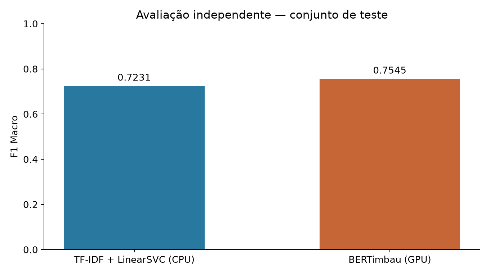

# ReviewSense PT-BR

Classificação de sentimentos em avaliações brasileiras de comércio eletrônico,
com pipeline de dados reproduzível, baseline **TF-IDF + LinearSVC**, fine-tuning
**BERTimbau** e demonstração local em **Gradio**.

**Escopo da v1.0.0:** código-fonte, documentação, resultados experimentais e
aplicação local. O clone **não contém os pesos treinados nem o dataset**.
Um [candidato dos pesos foi publicado posteriormente no Hugging Face](https://huggingface.co/JorgeRibeiru/reviewsense-ptbr-bertimbau),
mas sua verificação pós-download foi interrompida pelo validador seguro de cache.
**Não há inferência hospedada.** A integração ZeroGPU permanece preparada, sem deploy.

A [release v1.0.0](https://github.com/jorgeribeiru/Review-Sense/releases/tag/v1.0.0)
está publicada no commit `98845aa`, com esse escopo. A
[decisão do responsável](docs/RELEASE_RIGHTS_DECISION.md) autorizou o upload específico
sob incerteza jurídica, sem representar aprovação jurídica. A execução parou antes
de criar o Space; [estado, SHA e falha verificada](reports/validation_hf_publication_execution.md).
Os [materiais anteriores de divulgação](docs/PUBLIC_LAUNCH_COMMUNICATION.md) precisam
de revisão antes de uso e não foram publicados.

[Guia da release](docs/RELEASE_v1.0.0.md) ·
[Notas de lançamento](docs/RELEASE_NOTES_v1.0.0.md) ·
[Changelog](CHANGELOG.md) ·
[Histórico técnico](docs/HISTORICO_TECNICO.md)

## O que o projeto entrega

- Auditoria, limpeza e splits congelados com fingerprints para **126.692 avaliações**
  do B2W-Reviews01 após preparação, preservando acentos, caixa e negações.
- DummyClassifier como referência mínima e TF-IDF + LinearSVC com seleção por validação.
- Fine-tuning do BERTimbau, piloto de memória e retomada de treinamento, executados
  localmente na **NVIDIA RTX 3050 Laptop de 6 GB**.
- Avaliação final independente com protocolo congelado, métricas por classe e
  comparação descritiva entre modelos.
- Serviço de inferência reutilizável, cache por processo, CPU/GPU, limites de entrada,
  scores não calibrados, interface responsiva e exemplos sintéticos.
- Empacotamento por allowlist, SHA-256, validação de configuração e testes offline.
  Preparação ZeroGPU separada do backend local, sem deploy.

As classes são **derivadas das estrelas**, sem anotação manual de sentimento:

| Estrelas | ID | Classe |
| --- | ---: | --- |
| 1–2 | 0 | negativo |
| 3 | 1 | neutro |
| 4–5 | 2 | positivo |

## Resultados experimentais

Teste independente com **19.004 avaliações**, após seleção dos modelos somente
pela validação. Treino: **88.684**; validação: **19.004**. O teste foi avaliado uma
vez e está encerrado; a preparação desta release usa somente os resultados salvos.

| Modelo | F1 Macro de teste | Accuracy de teste |
| --- | ---: | ---: |
| TF-IDF + LinearSVC | **0,7231** | 0,8325 |
| BERTimbau | **0,7545** | 0,8634 |

Valores arredondados dos [agregados congelados](reports/phase3c_final_metrics.json).
Ganho descritivo relativo de F1 Macro: **4,34%**, sem alegação de superioridade
estatística. BERTimbau selecionado: **época 1, update 5543**, antes de abrir o teste.



[Relatório final](reports/validation_phase3c.md) ·
[Protocolo](docs/FASE3C_PROTOCOL.md) ·
[Comparação em notebook, somente agregados](notebooks/04_final_model_comparison.ipynb)

## Demonstração local

A interface permite analisar um texto com BERTimbau ou SVM. A figura abaixo é uma
**captura histórica da validação local com texto sintético**; não é uma demonstração
hospedada nem uma medição de desempenho de produção.


**Pré-requisitos:** Python 3.11/Linux no ambiente validado, stack PyTorch já
compatível com as constraints locais e acesso legítimo aos artefatos treinados.
O BERT padrão usa o pacote local 4B e seu descritor; o SVM usa seus artefatos locais.
O clone sozinho permite inspecionar código/resultados, mas não executar inferência
com os modelos treinados. A aplicação não baixa pesos automaticamente.

Com os [arquivos necessários](docs/RELEASE_v1.0.0.md#demonstração-local-com-artefatos-legítimos)
disponíveis, execute na raiz do projeto:

```bash
# Preservar o PyTorch CUDA funcional; não combinar com locks históricos incompatíveis.
.venv/bin/python -m pip install -r app/requirements.txt
HF_HUB_OFFLINE=1 TRANSFORMERS_OFFLINE=1 .venv/bin/python -m app.app --device auto
```

Abra **http://127.0.0.1:7860**. Use `--device cpu` para processamento em CPU.
O serviço carrega sob demanda e reutiliza o modelo. Não é necessário dataset.
Limite: **8.000 caracteres**, com truncamento BERT em **256 tokens**.
A aplicação não grava explicitamente textos em arquivos/logs; evite dados pessoais
ou sigilosos. Analytics, histórico, cache de exemplos e share ficam desativados.
Detalhes de instalação, artefatos e integridade no [guia da release](docs/RELEASE_v1.0.0.md).

## Reprodução e engenharia

O ambiente principal combina CPU e GPU local; Colab não é requisito desta release.
A documentação separa leitura de resultados, testes sintéticos e reprodução dos
experimentos. **Não reabrir test.csv, retreinar ou sobrescrever os artefatos congelados
para verificar esta versão.** Treinamentos independentes requerem dados legítimos,
recursos e saídas próprias; não garantem os mesmos pesos ou números.

| Área | Referência |
| --- | --- |
| Dados e decisões históricas | [Protocolo e histórico técnico](docs/HISTORICO_TECNICO.md) |
| Baseline clássico | [Guia TF-IDF/SVM](docs/FASE2_BASELINE.md) |
| Treino local e retomada | [Guia BERTimbau](docs/FASE3B_BERTIMBAU.md) |
| Inferência e integridade | [Guia de preparação](docs/FASE4C_RELEASE_READINESS.md) |
| Model Card e pacote local | [Model Card](publishing/model_card/README.md), [empacotamento](docs/FASE4B_MODEL_PACKAGING.md) |
| ZeroGPU preparado, não implantado | [Arquitetura e limites](docs/FASE4C_ZEROGPU.md) |
| Plano técnico completo | [ReviewSense PT-BR](ReviewSense_PTBR_PLANO.md) |

Com as dependências de desenvolvimento e da aplicação instaladas no ambiente completo:

```bash
HF_HUB_OFFLINE=1 TRANSFORMERS_OFFLINE=1 .venv/bin/pytest -q
.venv/bin/ruff check src tests app scripts deploy/zerogpu
.venv/bin/ruff format --check src tests app scripts deploy/zerogpu
.venv/bin/python -m pip check
```

Os testes usam artefatos sintéticos e não exigem download de modelos nem GPU real.
A última verificação e os limites do que foi testado estão no
[relatório de preparação da release](reports/validation_release_v1.md).
Não há workflow de CI configurado nesta versão; as evidências são de execução local.

## Limitações

- Corpus de avaliações de **produtos de 2018**; sem validação específica para delivery,
  restaurantes ou outros domínios.
- Rótulos por estrelas são uma proxy: texto e nota podem discordar.
- A classe **neutra** é a principal limitação: BERT com F1 **0,4454** e recall
  **0,3855** no teste, conforme os agregados congelados.
- Scores Softmax são **não calibrados**, sem interpretação de certeza estatística.
  O SVM retorna uma classe, sem probabilidades calibradas.
- Truncamento pode descartar contexto; ironia, opiniões mistas, dependências entre
  autores/produtos e quase duplicatas não foram avaliadas exaustivamente.
- Resultados dependem do corpus, protocolo e ambiente; não são SLA de produção.
  Testes locais de ZeroGPU não validam a infraestrutura compartilhada real.

## Atribuição, licença e disponibilidade

Dataset: [B2W-Reviews01](https://github.com/americanas-tech/b2w-reviews01), publicado
por B2W Digital/Americanas Tech; autores Livy Real, Marcio Oshiro e Alexandre Mafra.
Base: [BERTimbau da NeuralMind](https://huggingface.co/neuralmind/bert-base-portuguese-cased),
de Fábio Souza, Rodrigo Nogueira e Roberto Lotufo.

O [código próprio é MIT](LICENSE). Avisos de terceiros, inclusive fixtures Apache-2.0,
são preservados. A MIT não se estende automaticamente ao dataset ou aos pesos.
O original do corpus declara CC BY-NC-SA 4.0; há divergência com o espelho no Hub.
Direitos dos pesos: **REQUIRES_REVIEW / NOT_ESTABLISHED**. Houve autorização
operacional específica para o candidato público v2, com CC BY-NC-SA limitada aos
direitos controlados pelo responsável e avisos MIT separados. O pacote 4B original
permanece intacto, com upload_authorized=false.
A release de código não é aprovação jurídica para distribuir o modelo.

Finalidade educacional e não comercial prevista, sem parceria/endosso institucional.
A decisão de não solicitar autorização por e-mail permanece. A
[política de direitos e reclamações](docs/FASE4C_RIGHTS_OUTREACH.md) define atribuição,
transparência, canal para manifestações fundamentadas e eventual suspensão/retirada;
não presume autorização por silêncio, finalidade não comercial ou aviso de retirada.

A release v1.0.0 preserva seu escopo original de código, documentação e resultados.
O candidato de pesos publicado depois dela tem verificação pós-download incompleta.
Não há Space implantado ou URL de inferência validada; não se declara lançamento
hospedado concluído nem resolução jurídica dos direitos.
