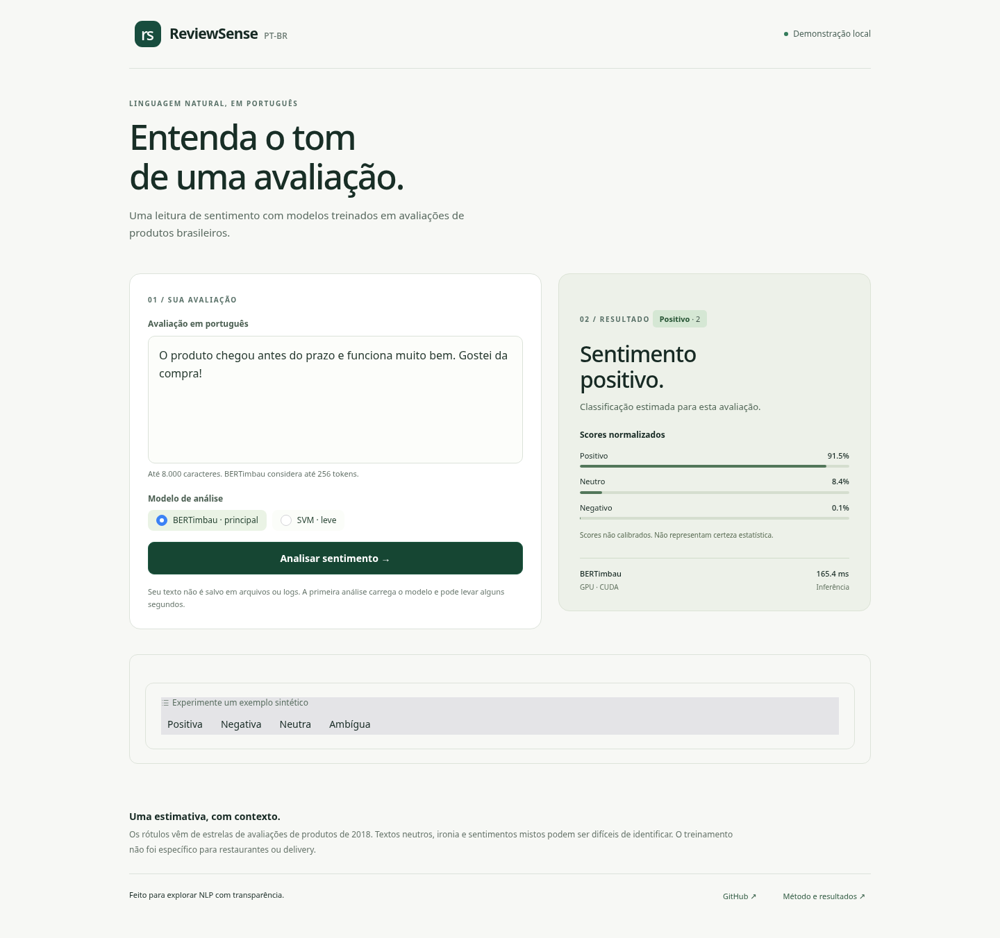

# ReviewSense PT-BR

Pipeline reprodutível de dados e classificação de polaridade de avaliações brasileiras,
seguindo [o plano técnico](ReviewSense_PTBR_PLANO.md). A Fase 1 prepara os dados;
a **Fase 2** compara DummyClassifier e TF-IDF + LinearSVC em CPU local, usando
apenas treino e validação. A **Fase 3A** executa um smoke de BERTimbau em GPU local,
limitado a 256/96 exemplos. A **Fase 3B** concluiu três épocas nos 88.684 textos
de treino, após piloto de GPU e prova de retomada. A **Fase 3C** concluiu a avaliação
independente no teste, com protocolo congelado e uma passagem por modelo. A **Fase 4A**
implementa o serviço de inferência reutilizável e a demonstração Gradio local. A
**Fase 4B** preparou Model Card e pacote independente; publicação segue bloqueada
por revisão de licenciamento e autorização pendente na Fase 4C.

As classes são derivadas das estrelas: **1–2 → negativo (0), 3 → neutro (1),
4–5 → positivo (2)**. Isso é uma proxy de sentimento, não uma anotação direta.
Os resultados futuros estarão inicialmente limitados a avaliações de produtos
no domínio do corpus; não comprovam generalização para delivery ou outros setores.

## Demonstração local — Fase 4A

Com a `.venv` CUDA existente e os modelos aprovados disponíveis:

```bash
.venv/bin/python -m pip install -r app/requirements.txt
.venv/bin/python -m app.app
```

Abra **http://127.0.0.1:7860**. BERTimbau é o padrão; o SVM é a alternativa leve.
O modo automático usa GPU quando disponível e permite CPU; para forçar CPU, use
`--device cpu`. Os modelos são carregados sob demanda e reutilizados.
**Pesos não estão no Git**: veja os arquivos necessários no
[guia da Fase 4A](docs/FASE4A_INFERENCE_GRADIO.md). Nenhum dataset é necessário.

A interface aceita até 8.000 caracteres e usa exemplos sintéticos. BERT exibe
scores normalizados **não calibrados**; SVM exibe apenas a classe. Textos não são
salvos em arquivos/logs; analytics, histórico, cache de exemplos e share estão
desativados. A aplicação não foi publicada externamente.



Validação local: **217 testes aprovados**, BERT/GPU, BERT/CPU, SVM e interface em
320–1440 px. Medianas de inferência aquecida, 12 requisições sintéticas por cenário:
**BERT/GPU 6.81 ms**, **BERT/CPU 31.57 ms**,
**SVM 4.29 ms**. Excluem carga, fila, HTTP e renderização;
não substituem os benchmarks de dataset da Fase 3C. Condições e evidências:
[phase4a_inference_smoke.json](reports/phase4a_inference_smoke.json).
A Fase 4B preparou o Model Card e o pacote; a publicação depende dos gates da Fase 4C.

## Preparação de distribuição — Fase 4B

**Tecnicamente concluída; pesos não publicados.** O candidato local do BERTimbau
contém nove arquivos de inferência/documentação, preserva os bytes do checkpoint
da época 1/update 5543 e carrega fora da estrutura de desenvolvimento. CPU/FP32 e
GPU/FP16 produziram classes e logits equivalentes ao original nos exemplos sintéticos.
A suíte ampliada tem **253 testes offline aprovados**.

**Licenciamento: `REQUIRES_REVIEW`; upload não autorizado.** O Model Card usa
`license: unknown`. A declaração MIT do base/código e a licença dos dados não
resolvem automaticamente a situação dos pesos ajustados. Consulte a
[auditoria e pendências](docs/FASE4B_LICENSE_REVIEW.md).

- [Model Card preparado](publishing/model_card/README.md).
- [Manifest, arquivos e hashes](reports/phase4b_package_manifest.json).
- [Relatório de equivalência e preservação](reports/validation_phase4b.md).
- [Guia de empacotamento e reprodução](docs/FASE4B_MODEL_PACKAGING.md).
- [Plano da Fase 4C](docs/FASE4C_RELEASE_PLAN.md): direitos/autorização, destino,
  publicação e demonstração verificadas, release e LinkedIn somente no encerramento.

O pacote com pesos está apenas em `outputs/phase4b/model-repo-staging/`, ignorado
pelo Git. Não houve treinamento, nova avaliação do teste ou operação de upload.
A aplicação local da Fase 4A continua utilizando seu carregador original.

## Ambiente principal

O desenvolvimento e as execuções usam o computador do desenvolvedor. As Fases 1/2
rodam em CPU; as Fases 3A/3B utilizam a RTX 3050 Laptop de 6 GB com PyTorch CUDA e FP16.
CPU e GPU podem ser usadas no mesmo ambiente
virtual. Não há uso de TPU previsto. Colab ou outra infraestrutura externa ficam
como alternativas se memória ou tempo de execução se tornarem limitantes.
A validação no Colab é opcional e não bloqueia esta fase.

## Instalação e execução local

Requer Python 3.11 ou superior. Execute os comandos na raiz do repositório:

```bash
python -m venv .venv
source .venv/bin/activate
python -m pip install -r requirements-dev.txt
python -m reviewsense.data
pytest -q
ruff check src tests
ruff format --check src tests
```

A execução baixa a revisão oficial fixada, valida seu checksum, audita, limpa e
salva os splits e relatórios em `data/processed/v1/`, ignorado pelo Git. O cache
fica em `data/raw/`. Para usar um CSV local e outra saída:

```bash
python -m reviewsense.data --csv data/raw/B2W-Reviews01.csv --output-dir data/processed/v2
```

O arquivo local pode ser outro recorte: o checksum é registrado, mas a validação
contra o checksum oficial só é obrigatória no download/cache padrão. Falhas de
esquema, notas ausentes/inválidas e corrupção do cache interrompem o pipeline.
Erros não são descartados silenciosamente. Uma saída existente também causa erro,
para preservar os splits congelados. O CLI não exige GPU nem conta no Hugging Face.

As dependências ficam no `pyproject.toml`; `requirements.txt` instala o pacote e
`requirements-dev.txt` inclui testes e ferramentas de notebook. Para repetir o
ambiente **local efetivamente validado em Python 3.11/Linux**, use:

```bash
python -m pip install -r requirements-lock.txt
```

O lock local não representa validação no Colab. A instalação por intervalos de
versões é o caminho inicial para testar outros ambientes.

## Fase 2 — Baseline clássico

Com os artefatos congelados da Fase 1 disponíveis, execute:

```bash
.venv/bin/python -m reviewsense.baseline
```

O padrão usa `data/processed/phase1-final/` e verifica os fingerprints de treino e
validação contra o manifest e `reports/data_audit_summary.json`. **Não execute o
pipeline de dados novamente e não use `load_artifacts` nesta fase**, pois essa
função abre também o CSV de teste. O carregador específico `load_training_data`
abre apenas os dois conjuntos permitidos.

A busca contém 12 combinações: `C` em 0,1/1/10, unigramas ou unigramas+bigramas,
e pesos padrão ou balanceados. A seleção usa F1 macro de validação; não há refit
em treino+validação. O modelo e o vocabulário ficam locais, fora do Git, em
`models/baseline/phase2-v1/`, com configurações, métricas e tempos. Para repetir,
escolha outra saída com `--output-dir`.

Consulte [o guia da Fase 2](docs/FASE2_BASELINE.md) para conceitos, decisões,
propósito das funções e reprodução. O notebook
[`02_tfidf_svm_baseline.ipynb`](notebooks/02_tfidf_svm_baseline.ipynb) reabre os
resultados salvos por padrão, sem repetir a busca.

Resultado real desta execução (validação):

| Modelo | F1 macro | Precision macro | Recall macro |
| --- | ---: | ---: | ---: |
| Dummy | 0,2545 | 0,2059 | 0,3333 |
| TF-IDF + LinearSVC | **0,7271** | **0,7283** | **0,7288** |

Vencedor: `C=0.1`, `ngram_range=(1,2)`, `class_weight=balanced`. A classe neutra
teve F1 de 0,4154 e permanece o principal limite. A busca completa levou cerca de
65 segundos neste computador. São resultados de validação usada na seleção;
não constituem uma avaliação final independente.

O [relatório da Fase 2](reports/validation_phase2.md) contém todas as configurações,
métricas por classe, matrizes de confusão, hardware, tempos e verificações.

## Fase 3A — Smoke do BERTimbau na GPU local

Com o PyTorch CUDA funcional já instalado, preserve sua variante e instale o extra:

```bash
.venv/bin/python -m pip install -r requirements-transformer-lock.txt
.venv/bin/python -m reviewsense.train_transformer --diagnose-only
.venv/bin/python -m reviewsense.train_transformer --output-dir models/bertimbau/phase3a-v2
```

A execução original está em `models/bertimbau/phase3a-v1/`, ignorada pelo Git. O
comando acima usa outra saída para preservá-la. Configuração: 256 exemplos de treino,
96 de validação, max_length 128, batch 2, acumulação 8, uma época e FP16. Não
regenera splits, não abre o teste, não usa Colab e não publica no Hub.

O primeiro ciclo completou **16 atualizações em CUDA**, sem OOM, com pico de
**2,032 GiB alocados / 2,088 GiB reservados** pelo PyTorch. Treino: **5,492 s**;
avaliação: **0,423 s**. O modelo salvo foi recarregado com tokenização e predições
idênticas. O F1 macro diagnóstico foi **0,2538**, com todas as predições positivas;
esse resultado não é comparável ao baseline treinado na base completa.

Veja o [relatório da Fase 3A](reports/validation_phase3a.md) para evidências de GPU,
versões, VRAM, métricas por classe e próximos passos. O
[guia do smoke](docs/FASE3A_BERTIMBAU_SMOKE.md) explica as funções, amostragem,
precisão mista, acumulação, proteção do Torch e a única alternativa em caso de OOM.

## Fase 3B — Fine-tuning completo local

O piloto comparou 128/batch 2, 256/batch 2 e 256/batch 4 usando os mesmos textos,
incluindo avaliações longas. Batch 4 coube, mas apresentou overflow de gradientes;
a escolha conservadora foi **256 tokens, batch 2, acumulação 8 (efetivo 16)**,
FP16 e LR 2e-5. A decisão usou estabilidade e memória, sem consultar F1.

Após comprovar retomada em processos CUDA separados, o treino completou três épocas
com os splits congelados. O F1 Macro de validação foi **0,7555 / 0,7412 / 0,7497**;
o melhor checkpoint é o da **época 1, update 5543**, salvo também em
`models/bertimbau/phase3b-full-v3/best_model/`. As épocas seguintes não melhoraram
a métrica de seleção. O baseline SVM obteve 0,7271 nos mesmos splits; ambos usaram
a validação para seleção, portanto essa comparação não substitui o teste final.

O [relatório da Fase 3B](reports/validation_phase3b.md) contém métricas por classe,
matriz de confusão, duração, VRAM e incidentes AMP. O
[guia de reprodução](docs/FASE3B_BERTIMBAU.md) documenta funções, configuração,
piloto e checkpoints completos. Consulte os resultados sem repetir o treino em
[`notebooks/03_bertimbau_finetune.ipynb`](notebooks/03_bertimbau_finetune.ipynb).
Pesos, tokens individuais e estados de otimização permanecem locais e fora do Git.
Não houve uso de Colab nem publicação no Hub.

## Fase 3C — Avaliação final independente concluída

O protocolo e o código foram congelados no commit `90893aa` antes da abertura do
teste. O preflight validou modelos offline e GPU com zero acessos ao teste. A
execução definitiva fez **uma leitura do CSV e uma passagem por modelo** nos
mesmos **19.004 textos**, sem treino, refit, calibração ou nova seleção.

| Modelo | F1 Macro de teste | Accuracy de teste |
| --- | ---: | ---: |
| TF-IDF + LinearSVC | 0,723094 | 0,832509 |
| BERTimbau época 1/update 5543 | 0,754461 | 0,863397 |

Diferença absoluta de F1 Macro (BERT−SVM): **0,031367**.
O candidato principal continua sendo o BERTimbau, definido antes do teste.
A comparação é descritiva, sem alegação de superioridade estatística.
Resultados de validação das fases anteriores permanecem preservados.

Consulte o [relatório final](reports/validation_phase3c.md), as
[métricas estruturadas](reports/phase3c_final_metrics.json), o
[protocolo congelado](docs/FASE3C_PROTOCOL.md) e o
[guia técnico](docs/FASE3C_FINAL_EVALUATION.md). O
[notebook 04](notebooks/04_final_model_comparison.ipynb) só inspeciona agregados.
Para regenerar tabelas/figuras a partir da execução salva, sem nova inferência:

```bash
.venv/bin/python -m reviewsense.final_evaluation --render-saved
```

A execução final está encerrada; o marcador local impede repetição, inclusive
após falha. O teste agora é informação observada e não deve orientar ajustes neste
experimento. A Fase 4A implementa a demonstração local; Model Card, licenciamento
e preparação da publicação permanecem para a Fase 4B.

## Notebook local e alternativa no Google Colab

Abra [`notebooks/01_data_audit_eda.ipynb`](notebooks/01_data_audit_eda.ipynb).
Execute-o localmente com o kernel da `.venv`, após instalar as dependências de
desenvolvimento. A auditoria utiliza os módulos do pacote e não requer GPU.

Se os recursos locais se tornarem limitantes e você optar pelo Colab, o notebook
também inclui instruções de preparação. Para clonar, os commits devem estar no
remoto; alternativamente, transfira o repositório completo para a sessão.

Depois de clonar/transferir a pasta no Colab:

```python
%cd /content/Review-Sense
%pip install -r requirements-dev.txt
```

Execute as células em ordem. Se o notebook estiver em outra pasta, defina a variável
`REVIEWSENSE_REPO` com o caminho da raiz. Uma célula de exportação fica desativada
por padrão; ela usa a mesma política de não sobrescrever diretórios existentes.
Salve os artefatos locais fora de `/content` antes de encerrar a sessão. Evite
versionar notebooks com saídas que exponham avaliações ou dados pessoais.

## Protocolo de dados

1. Validar `review_text` e `overall_rating`. Notas devem ser números inteiros de 1 a 5;
   textos podem estar ausentes para que o descarte seja auditado. Valores textuais
   como `NA` e `null` são preservados. Metadados extras são auditados, não usados como entrada.
2. Auditar nulos por coluna, distribuição de notas/classes, textos vazios,
   duplicatas de linhas e textos, conflitos e comprimentos em caracteres/palavras.
3. Normalizar Unicode NFC, controles ASCII e espaços. Preservar caixa, acentos,
   pontuação, emojis e negações. Não usar stemming nem remover stopwords.
4. Remover textos vazios e **todas** as linhas de grupos de textos normalizados
   idênticos com classes conflitantes. Notas diferentes dentro da mesma classe
   são contadas na auditoria, mas não constituem conflito de classe.
5. Manter um exemplar de cada texto normalizado restante, mesmo que tenha autores
   ou produtos diferentes. A auditoria e o relatório de limpeza permitem observar
   a mudança na distribuição. Não se tenta corrigir discrepâncias semânticas texto-nota.
6. Gerar `sample_id` por SHA-256 do texto normalizado e ordenar por ele. Dividir
   por classe, aproximadamente **70/15/15**, com semente **42**, usando
   [`configs/data.json`](configs/data.json). As proporções podem variar pelo arredondamento.
   A ordem do CSV não altera os splits. Falhar se não for possível estratificar
   com todas as classes presentes em cada conjunto.
7. Verificar ausência de interseção de IDs/textos e cobertura exata do conjunto
   preparado, incluindo os rótulos. Salvar IDs, fingerprints e versões no manifest.
   Para reabrir os dados em fases futuras, usar `load_artifacts`, que verifica
   novamente os arquivos contra o manifest e preserva textos como `NA` e `null`.

```python
from reviewsense.data import load_artifacts

splits, manifest, audit = load_artifacts("data/processed/v1")
```

A garantia de disjunção cobre **textos normalizados idênticos**, não paráfrases,
textos quase iguais, produtos ou autores compartilhados. O split aleatório também
não mede generalização temporal. Essas análises ficam para etapas futuras.
O CSV preparado tem apenas `sample_id`, `review_text` e `label`; metadados e estrelas
não ficam disponíveis como features. O rótulo é exclusivamente o alvo.

## Organização

```text
configs/data.json                   # Configuração executável dos splits
configs/train.yaml                  # Reserva para fases futuras
src/reviewsense/labels.py            # Contrato de classes
src/reviewsense/data.py              # Download, validação, auditoria, limpeza, splits e CLI
src/reviewsense/frozen_data.py       # Leitura exclusiva e verificada de treino/validação
src/reviewsense/baseline.py          # Dummy, grade pequena, seleção, tempos e persistência
src/reviewsense/evaluate.py          # Métricas, benchmark e matriz de confusão
src/reviewsense/transformer_data.py  # Configuração e amostras limitadas do smoke
src/reviewsense/train_transformer.py # Fine-tuning diagnóstico em CUDA, métricas e recarga
src/reviewsense/phase3b_data.py       # Comprimentos, cache e escolha computacional
src/reviewsense/gpu_benchmark.py      # Benchmark controlado e monitor NVML
src/reviewsense/train_bertimbau.py    # Treino completo, seleção e estado retomável
src/reviewsense/phase3b.py            # CLI de preparação, piloto e gates
src/reviewsense/final_evaluation.py   # Preflight e avaliação única, sem ajuste
src/reviewsense/final_reporting.py    # Relatório e figuras a partir de agregados
src/reviewsense/predict.py           # Serviço local: cache, integridade, CPU/GPU e scores
notebooks/01_data_audit_eda.ipynb     # Auditoria e gráficos usando os módulos
notebooks/02_tfidf_svm_baseline.ipynb  # Comparação dos modelos na validação
configs/baseline.json                # Grade e condições de medição da Fase 2
configs/bertimbau_smoke.json          # Orçamento e configuração da Fase 3A
configs/bertimbau_phase3b.json        # Configuração do treino completo
docs/FASE2_BASELINE.md                # Conceitos, funções e reprodução
tests/                              # Testes offline com exemplos sintéticos
app/                                # Gradio local e estilos, sem lógica duplicada de modelos
scripts/verify_phase4a_local.py      # Smoke sintético opcional com modelos originais
data/README.md                      # Proveniência, licença e artefatos locais
reports/validation_phase1.md         # Evidências da validação executada
reports/data_audit_summary.json      # Resumo agregado, sem textos ou IDs de avaliações
reports/validation_phase2.md         # Comparação real, medições e limites da Fase 2
reports/baseline_validation.json      # Métricas completas e proveniência do experimento
reports/validation_phase3a.md         # Diagnóstico e evidências do smoke em GPU
reports/bertimbau_smoke_metrics.json  # Métricas agregadas, VRAM e verificação de recarga
notebooks/03_bertimbau_finetune.ipynb # Inspeção dos resultados, sem treinar
reports/validation_phase3b.md         # Piloto, três épocas, memória e retomada
reports/bertimbau_phase3b_metrics.json # Métricas agregadas e verificações finais
notebooks/04_final_model_comparison.ipynb # Comparação final sem repetir inferência
reports/validation_phase3c.md         # Avaliação final independente
reports/phase3c_final_metrics.json    # Métricas definitivas e condições de execução
reports/figures/                     # Destino de figuras agregadas
```

O workflow de CI continua reservado a uma etapa posterior.
O extra Transformer é opcional e preserva o PyTorch CUDA já instalado. A aplicação
Gradio possui dependências próprias em app/requirements.txt. Os testes comuns não baixam pesos nem
exigem GPU; testes opcionais usam um BERT minúsculo criado localmente em CPU.

## Fonte e licença

B2W Digital, [B2W-Reviews01](https://github.com/americanas-tech/b2w-reviews01),
Americanas.com, janeiro–maio de 2018. O original declara **CC BY-NC-SA 4.0**;
o espelho no Hugging Face informa uma licença divergente. Usamos a declaração
original como referência. Consulte [data/README.md](data/README.md) para atribuição,
revisão e checksum. A [licença MIT](LICENSE) cobre somente o código do projeto.


## Fase 4C — Preparação local; lançamento pendente

A engenharia de preparação usa o pacote 4B com um
[descritor público separado](publishing/inference_descriptor.json), resolvedor
local verificado e adaptador de cache HF opcional por revisão imutável. O padrão
continua offline/local; não há downloads, upload ou autenticação automáticos.
`ArtifactPaths` explícito preserva a resolução histórica da aplicação.

```bash
HF_HUB_OFFLINE=1 TRANSFORMERS_OFFLINE=1 .venv/bin/python \
  -m scripts.verify_phase4c_readiness --dry-run --device cpu
.venv/bin/python -m app.app --device cpu --preload
```

O dry-run executa inferência sintética local e separa prontidão técnica, revisão
jurídica, destino e autorização. Direitos **REQUIRES_REVIEW**, upload **false**:
a Fase 4C não está encerrada e a inferência pública permanece bloqueada.

- [Arquitetura, funções, comandos e cenários de encerramento](docs/FASE4C_RELEASE_READINESS.md)
- [Política de direitos e reclamações; sem solicitações por e-mail](docs/FASE4C_RIGHTS_OUTREACH.md)
- [Hospedagem e elegibilidade, sem contratação](docs/FASE4C_HOSTING_DECISION.md)
- [Evidências da preparação](reports/validation_phase4c_readiness.md) e [correções pré-merge](reports/phase4c_premerge_corrections.md)

A aplicação não grava explicitamente entradas; serviços de hospedagem podem manter
registros e controles próprios. Não enviar dados pessoais/sigilosos. Sem nova
leitura do teste, treino ou alteração de pesos. Nenhum Space/release/post foi
publicado por esta preparação; LinkedIn fica para depois da validação pública.


## ZeroGPU — adaptação local preparada, sem deploy

Na branch `feat/phase4c-zerogpu-readiness`, entrada dedicada em
[deploy/zerogpu](deploy/zerogpu/README.md), adaptador eager separado do backend
local e bundle de código por allowlist, sem pesos/datasets/relatórios. A UI é
reutilizada, com BERTimbau apenas, concorrência limitada e erros sanitizados.

```bash
HF_HUB_OFFLINE=1 TRANSFORMERS_OFFLINE=1 .venv/bin/python \
  -m reviewsense.space_bundle --destination outputs/phase4c-zerogpu/reproduction
```

Conta informada: `JorgeRibeiru`; os nomes de modelo/Space continuam candidatos.
Alvo Python 3.12.12/PyTorch 2.13.0, sem alterar o ambiente CUDA local. A matriz foi
conferida por documentação/metadata; testes usam CPU/modelos minúsculos e emulação
de controle de fluxo, sem validar o hardware compartilhado real.
**REQUIRES_REVIEW; upload_authorized=false.** Nenhum Space foi criado, autenticado
ou publicado, nem houve download de pesos. A política de não solicitar autorizações
por e-mail permanece. Veja [arquitetura e pendências](docs/FASE4C_ZEROGPU.md) e
[evidências](reports/validation_phase4c_zerogpu.md).
