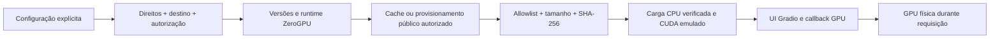

# Fase 4C — Preparação ZeroGPU local

**Adaptação preparada; publicação bloqueada. Fase 4C não encerrada.**
`license_status=REQUIRES_REVIEW`, `upload_authorized=false`. Conta `JorgeRibeiru`
confirmada pelo usuário, sem autenticação/consulta da conta nesta execução.
Modelo candidato: `JorgeRibeiru/reviewsense-ptbr-bertimbau`; Space candidato:
`JorgeRibeiru/reviewsense-ptbr`. Não se presume que esses repositórios existam.
A decisão de não solicitar autorizações por e-mail e a
[política de direitos/reclamações](FASE4C_RIGHTS_OUTREACH.md) permanecem intactas.

## Fontes e condições do provedor

Consulta em 2026-10-30. A [documentação oficial ZeroGPU](https://huggingface.co/docs/hub/spaces-zerogpu)
lista Gradio 4+, Python 3.10.13/3.12.12 e PyTorch 2.13.0 entre as versões suportadas.
Contas pessoais gratuitas elegíveis (e-mail verificado, mais de 30 dias) podem
hospedar até dois Spaces ZeroGPU; PRO até dez. O recurso é compartilhado, Gradio-only,
com filas e quotas por visitante: anônimo 2 min/dia, gratuito 5, PRO 40 (extensível).
Não comprar créditos nem presumir elegibilidade do usuário a partir do nome da conta.

A [visão geral](https://huggingface.co/docs/hub/spaces-overview) distingue isso do
CPU Basic para novas aplicações Gradio/Docker, condicionado a plano pago. Não há
fallback automático de hospedagem, compra ou infraestrutura gratuita garantida.

CUDA é emulado no startup; GPU física é atribuída quando a função GPU decorada
executa. O [guia técnico mantido pelo Hugging Face](https://github.com/huggingface/skills/blob/main/skills/huggingface-spaces/SKILL.md)
reforça importar spaces antes de torch e colocar o modelo em CUDA antes do callback.
Também orienta deixar pacotes geridos pelo runtime fora do requirements. Sua lista
curta de Torch estava menos atual que a documentação ZeroGPU; para versões foi
adotada a página específica atual. Nenhuma instrução de login/deploy desses guias
foi executada. O código público de [spaces 0.51.3](https://pypi.org/project/spaces/0.51.3/)
foi inspecionado em wheel Python temporário, sem instalação: decorador, emulação,
contexto Gradio e workers são mecanismos próprios do provedor, não CUDA local.

## Arquitetura e inicialização



`reviewsense.zerogpu` não importa spaces/torch ao ser importado. A factory valida
os gates e a matriz, exige SPACES_ZERO_GPU=true, ordem de importação correta e
Config.zero_gpu ativo. Não usa torch.cuda.is_available para simular ZeroGPU.
Só então importa o runtime e prepara `ZeroGPUInferenceService` fora do callback.

O adaptador herda `InferenceService`, mas substitui prepare: resolve o pacote,
confere integridade, reutiliza load_bert_cpu (tokenizer cased, labels, três classes,
pesos finitos) e executa uma única model.to("cuda"). Não consulta capacidade CUDA
no startup emulado e não roda kernels de inferência nesse momento. eval é aplicado;
o forward usa inference_mode, autocast FP16, 256 tokens e microbatch 2 da implementação
existente. prepare é idempotente; requisições não carregam pesos nem repetem to.
Sem preparo ou com erro de carga, não se constrói a UI. Não há lazy load ou
recuperação CPU no adaptador ZeroGPU; o backend local mantém esses comportamentos.

A carga é uma por instância/processo de inicialização. O runtime pode criar/reutilizar
workers e reconstruir processos; não se promete um único objeto global entre réplicas
ou reinícios. A colocação inicial e o custo de hidratação precisam de medição real.

`create_app` mantém o design e recebe um transformador opcional do callback.
O callback usa spaces.GPU(duration=10); um wrapper com functools.wraps preserva
metadata zerogpu e contexto do Gradio e sanitiza falhas do scheduler fora da função.
Botão/Enter compartilham a mesma função, concorrência 1 e fila 8. Entradas vazias,
acima de 8.000 caracteres ou outro modelo são rejeitadas antes da alocação. Duração
10 s é orçamento inicial conservador, **não medição nem SLA**. A documentação usa
60 s como duração padrão e permite configurar a solicitação; não foi confirmado
um teto universal de concessão, que depende de quota/política do provedor. Validar carga fria,
filas/timeout/quota em hardware real antes de divulgação. Não repetir automaticamente
requisições com falha, pois isso pode consumir quota.

A UI oferece apenas BERTimbau, exemplos sintéticos, indicador de processamento,
Softmax não calibrado e limitações do corpus/delivery. Não há logging explícito de
textos, histórico/cache de exemplos ou túnel share. A plataforma pode manter logs,
controles e políticas próprios. Erros não reproduzem entrada, caminhos ou tracebacks.

## Separação de dependências e compatibilidade local

`artifacts.py` extrai contratos/checksums/validações já existentes, sem pandas,
sklearn ou módulos de dados. `model_packaging` reexporta as funções anteriores.
`local_inference.py` contém caminhos/registros históricos e carga SVM; é opcional
e excluído do bundle. A API e o default local permanecem; ArtifactPaths explícito
continua suportado. A constante legada MODEL_PREFIX mantém importação compatível
sob demanda. AppSettings local fornece seus caminhos históricos; hosted nunca
habilita SVM. Não se copia data.py, baseline.py, train_transformer.py ou ferramentas
de avaliação para o Space. Não há alteração de treinamento ou predição aprendida.

## Matriz de deploy

| Componente | Alvo | Seleção/estado |
| --- | --- | --- |
| Python | 3.12.12 | Metadata do Space; documentado pelo ZeroGPU |
| PyTorch | 2.13.0, build CUDA do provedor | Gerido pelo runtime; +cpu rejeitado |
| spaces | 0.51.3 | Gerido pelo runtime; código/metadata consultados |
| Gradio | 6.31.0 | sdk_version no README; mesma UI validada localmente |
| huggingface-hub | 2.4.0 | Gerido pelo runtime; cache conhecido |
| Transformers | 5.22.1 | requirements; requer Python >=3.11, inviabiliza alvo 3.10 |
| tokenizers / safetensors | 0.23.3 / 0.8.0 | requirements |
| NumPy | 2.4.6 | requirements |

[Metadata Transformers](https://pypi.org/project/transformers/5.22.1/) e dos demais
pacotes foi verificado estaticamente para Python 3.12 e relações entre os oito
pacotes selecionados; evidência em
[phase4c_zerogpu_dependencies.json](../reports/phase4c_zerogpu_dependencies.json).
Não se resolveu toda a árvore transitiva, instalou outra matriz ou validou ABI/CUDA.
O runtime é gerido pelo provedor e pode divergir: o startup recusa versões diferentes
até nova revisão, em vez de trocar silenciosamente a stack. Local continua Python
3.11/PyTorch 2.14.1+cu132; nenhum pacote da .venv foi instalado/substituído.

## Estrutura e preparação offline

`deploy/zerogpu/` contém app.py, README.md, requirements.txt e runtime.json.
Conforme a [referência de configuração](https://huggingface.co/docs/hub/spaces-config-reference),
README define SDK/versão, Python e app_file; **não** configura preload_from_hub,
o que baixaria modelos antes dos gates da aplicação. Hardware não é contratado
por metadata. A [documentação de dependências](https://huggingface.co/docs/hub/spaces-dependencies)
orienta requirements para pacotes adicionais. Não aplicar esse arquivo ao ambiente
local; ele não reinstala torch, spaces, Gradio ou huggingface-hub geridos pelo runtime.

Gerar candidato de código independente, sem sobrescrever destino existente:

```bash
HF_HUB_OFFLINE=1 TRANSFORMERS_OFFLINE=1 .venv/bin/python \
  -m reviewsense.space_bundle --destination outputs/phase4c-zerogpu/reproduction
```

O preparador usa allowlist fixa e SHA-256; inclui somente:

```text
app.py  README.md  requirements.txt  runtime.json  LICENSE  model_descriptor.json
app/{__init__.py,app.py,config.py,style.css}
reviewsense/{__init__.py,labels.py,artifacts.py,model_resolution.py,hub_cache.py,predict.py,zerogpu.py}
```

São 17 arquivos de código/configuração. Fonte reutilizada é copiada localmente,
não mantida em duplicação manual. Pacote 4B e descritor original permanecem intactos;
o bundle contém só uma cópia do descritor. Pesos, datasets, relatórios, estados,
caches, tokens e aprovações privadas não entram. Symlinks, extras, hashes diferentes
e padrões conhecidos de segredos são rejeitados. Isso não é um scanner universal.

A entrada é importável sem lançar servidor. A execução recusa configuração ausente
ou direitos pendentes com mensagem sanitizada. O teste independente executa o bundle
fora do repo, bloqueia rede e acessos às origens, sem importar módulos de treinamento.
O código de lançamento em 0.0.0.0 só é alcançável no futuro runtime autorizado; nada
foi servido publicamente nesta entrega. share permanece false.

## Provisionamento futuro e autorização

Configurar explicitamente repo_id, SHA de 40 caracteres, cache root, approval root
e SPACE_ID. O padrão só usa `HubSnapshot`/`hub_cache` offline e materializa blobs
aprovados como arquivos regulares. Cache ausente falha; não há fallback para main,
modelo base, outro namespace ou trust_remote_code=True.

Existe provisionamento público opcional, depois dos gates e de opção separada:
snapshot_download por SHA, allowlist exata, token=False e sem autenticação.
Nenhum download real de pesos foi executado; testes usam mock e cache sintético.
Não habilitar essa opção enquanto o candidato atual permanecer REQUIRES_REVIEW.
A flag isolada não supera direitos/destino/autorização. O recibo humano futuro também
precisa space_id igual e ação host_zerogpu, além das condições anteriores.
Não foram geradas aprovações artificiais para o modelo real; documentos privados
não acompanham o bundle. A análise material de direitos e a autorização humana
continuam necessárias, independentemente da política de reclamações/retirada.

## Validação real posterior e reversão

Somente após resolver direitos, revisar candidato/licença, autorizar os destinos
e confirmar elegibilidade/recursos: conferir imagem/versões reais, provisionar
snapshot público aprovado por SHA, verificar hashes e inicialização emulada,
validar uma alocação real, reuso de workers, primeira requisição, aquecimento,
quota/fila/timeout e memória. Comparar inferência sintética e logs, testar erros,
layout móvel e tratamento de dados; nunca abrir/reavaliar test.csv. Registrar SHAs
de código/modelo e condições. Não anunciar link antes de acesso público verificado.

Se um futuro deploy falhar: suspender a demonstração afetada; preservar evidências
sem textos pessoais; reverter código e snapshot somente para revisões anteriores
já aprovadas e revalidar. Sem versão aprovada anterior, manter indisponível.
Não substituir por base/SVM ou contratar CPU/GPU automaticamente. Toda operação
remota/reversão exige autorização correspondente; nenhum rollback foi executado.

Pendentes: direitos e licença dos pesos, aprovação de candidato/destinos, recibos
humanos, confirmação de elegibilidade/quotas da conta, matriz/imagem e GPU reais,
canal de reclamações monitorado, deploy e revisão pública. LinkedIn permanece
para o encerramento após materiais públicos definitivos e verificados.

**Adaptação ZeroGPU preparada localmente. Deploy, distribuição dos pesos e encerramento da Fase 4C ainda pendentes.**
