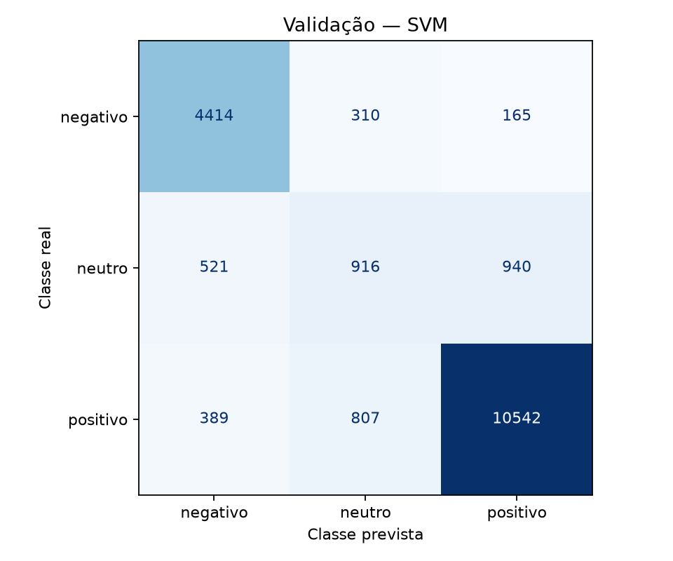
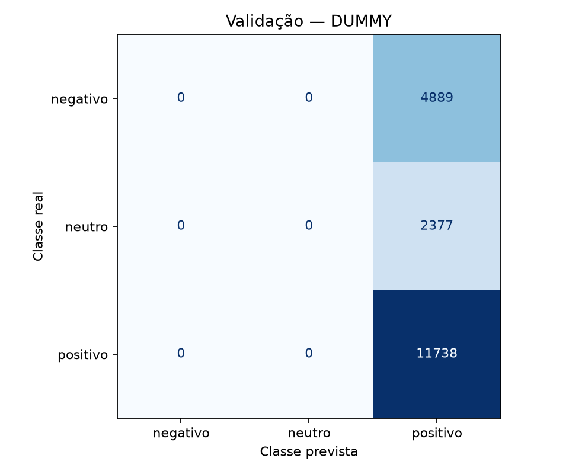

# Fase 2 — Resultados reais e validação local

Execução em **30/10/2026**, das **10:45:15 às 10:46:20**, horário de Recife (UTC−3).
Branch: `feat/phase2-classical-baseline`. Código treinado no commit
`fac70cc51ca6e70856fd1d5e27bb64a2ee56a931`, com árvore limpa. Os hashes dos módulos estão no JSON.

**Selecionado: TF-IDF + LinearSVC, candidato 8, C=0,1,
unigramas+bigramas e class_weight=balanced.** F1 macro de validação:
**0.727137**. O teste final não foi aberto nem usado, e
nenhum BERTimbau ou GPU foi utilizado.

## Dados e protocolo

- Treino: **88.684** avaliações. Validação: **19.004** avaliações.
- Artefatos congelados: `data/processed/phase1-final/`, sem regenerar splits.
- Fonte, política, IDs, contagens e fingerprints de treino/validação conferidos
  contra manifest local e `reports/data_audit_summary.json` da Fase 1.
- Somente `review_text` como entrada; `label` como alvo. IDs não são features.
- Cada candidato ajustou vocabulário/IDF e SVM exclusivamente no treino.
- Grade de 12 candidatos definida antes da execução; nenhum experimento adicional
  foi introduzido após observar resultados. Todos convergiram sem avisos.
- Seleção pelo F1 macro de validação; sem refit em treino+validação.

A função `load_artifacts` da Fase 1 não foi utilizada: ela abriria os três CSVs.
Foi criado um carregador específico na Fase 2, sem alterar `data.py`, `labels.py`,
a política de limpeza, os splits ou o notebook 01.

A execução real incluiu uma guarda de abertura de arquivos que abortaria qualquer
acesso ao `test.csv` real: **zero tentativas registradas**. Os SHA-256 de train.csv,
val.csv e manifest.json foram iguais antes e depois. O CSV de teste não foi sequer
lido para calcular checksum. Evidências agregadas:
[baseline_access_verification.json](baseline_access_verification.json).

## Comparação na validação

| Modelo | F1 macro | Precision macro | Recall macro | Accuracy |
| --- | ---: | ---: | ---: | ---: |
| Dummy (classe majoritária) | 0.2545 | 0.2059 | 0.3333 | 0.6177 |
| TF-IDF + LinearSVC | 0.7271 | 0.7283 | 0.7288 | 0.8352 |

Dummy sempre prevê positivo. Sua accuracy de 61,77% decorre da classe majoritária,
mas ele não recupera nenhum negativo ou neutro. O SVM acrescenta
**0.4726** de F1 macro nesta validação.

| Modelo | Classe | Precision | Recall | F1 | Suporte |
| --- | --- | ---: | ---: | ---: | ---: |
| Dummy | negativo | 0.0000 | 0.0000 | 0.0000 | 4889 |
| Dummy | neutro | 0.0000 | 0.0000 | 0.0000 | 2377 |
| Dummy | positivo | 0.6177 | 1.0000 | 0.7636 | 11738 |
| SVM | negativo | 0.8291 | 0.9028 | 0.8644 | 4889 |
| SVM | neutro | 0.4506 | 0.3854 | 0.4154 | 2377 |
| SVM | positivo | 0.9051 | 0.8981 | 0.9016 | 11738 |

A classe neutra é o principal limite: o SVM reconheceu **916 de 2.377** neutros;
521 foram previstos como negativos e 940 como positivos. Esse resultado requer
análise semântica futura; as métricas sozinhas não identificam a causa dos erros.

Matrizes: linhas reais, colunas previstas, ordem negativo/neutro/positivo.





## Todas as configurações experimentadas

O objetivo de C=0,1/1/10 é comparar regularização maior/intermediária/menor; n-grams
comparam palavras isoladas com inclusão de pares; pesos balanceados testam a
compensação do desbalanceamento. Demais escolhas permanecem fixas em
[configs/baseline.json](../configs/baseline.json).

| ID | C | N-grams | Peso | F1 macro | Precision macro | Recall macro | Treino (s) | Convergiu |
| --- | ---: | --- | --- | ---: | ---: | ---: | ---: | --- |
| 1 | 0.1 | (1, 1) | None | 0.653897 | 0.740241 | 0.655894 | 1.692 | Sim |
| 2 | 0.1 | (1, 1) | balanced | 0.712358 | 0.710125 | 0.716149 | 1.802 | Sim |
| 3 | 1 | (1, 1) | None | 0.667364 | 0.707582 | 0.663260 | 2.788 | Sim |
| 4 | 1 | (1, 1) | balanced | 0.694140 | 0.690881 | 0.697736 | 2.902 | Sim |
| 5 | 10 | (1, 1) | None | 0.649513 | 0.664307 | 0.645366 | 5.558 | Sim |
| 6 | 10 | (1, 1) | balanced | 0.663336 | 0.660868 | 0.666355 | 6.391 | Sim |
| 7 | 0.1 | (1, 2) | None | 0.677803 | 0.763840 | 0.675190 | 3.969 | Sim |
| 8 | 0.1 | (1, 2) | balanced | 0.727137 | 0.728256 | 0.728771 | 3.879 | Sim |
| 9 | 1 | (1, 2) | None | 0.700182 | 0.729857 | 0.693476 | 5.524 | Sim |
| 10 | 1 | (1, 2) | balanced | 0.710673 | 0.710401 | 0.712202 | 5.594 | Sim |
| 11 | 10 | (1, 2) | None | 0.680196 | 0.685106 | 0.676704 | 8.630 | Sim |
| 12 | 10 | (1, 2) | balanced | 0.679692 | 0.679638 | 0.679746 | 9.124 | Sim |

Nesta grade, pesos balanceados e C menor deram o melhor F1 macro. Isso não prova
que a mesma configuração será melhor em outros dados. A seleção usou os números
completos, sem arredondamento. Nenhum desempate foi necessário para o vencedor.

## Tempos e hardware

- CPU: **13th Gen Intel(R) Core(TM) i5-13450HX**, 16 CPUs lógicas disponíveis.
- RAM física informada pelo sistema: **23.15 GiB**.
- Python 3.11.14, Scikit-learn 1.9.1,
  NumPy 2.4.6, pandas 3.1.0.
- CPU somente; candidatos sequenciais. OpenBLAS/OpenMP limitados a **uma thread**.
- Treino inclui TF-IDF + SVM do candidato. O vocabulário vencedor tem
  **80.000 features**; SVM convergiu em 12 iterações.
- Inferência: **19.004 textos**, lotes de **256**, **um lote de aquecimento** e
  **três repetições**; mediana do tempo de passagem completa, sem I/O de disco.
  No SVM, inclui transformação TF-IDF e classificação; Dummy ignora o texto.

| Modelo | Ajuste completo (s) | Inferência, mediana (s) | ms/texto amortizado em lote |
| --- | ---: | ---: | ---: |
| Dummy | 0.002778 | 0.008529 | 0.000449 |
| SVM selecionado | 3.878721 | 0.434991 | 0.022889 |

Busca e validação: **62.630 s**.
Execução incluindo carga, verificação e serialização, até a escrita do relatório:
**65.190 s**.
Pico de memória do processo inteiro: **467.25 MiB**.
O arquivo do modelo tem **2.772.715 bytes** (joblib comprimido).

Os números por texto são throughput amortizado, não latência individual. A carga
da máquina e a frequência/temperatura da CPU não foram isoladas. Não se deve
compará-los diretamente com medições de GPU ou outros computadores.

## Verificação da entrega

- **97 testes aprovados**, incluindo os 74 da Fase 1 e os novos testes offline.
- Ruff (lint e formatação) aprovado; dependências consistentes segundo `pip check`.
- Testes de grade limitada, TF-IDF ajustado apenas no treino, preservação de
  acentos/negações, rejeição de vazamento/adulteração e não seleção sem convergência.
- Modelo salvo, checksum calculado e modelo recarregado: predições de validação
  idênticas às anteriores. Nenhuma predição individual foi publicada.
- Notebook 02 executado com **seis células de código e zero erros**, reabrindo a
  execução salva sem repetir a busca. A mesma guarda bloqueava abertura do teste
  durante o notebook. O arquivo versionado está sem saídas.
- Código/política de dados da Fase 1 e seus artefatos preservados.

Artefatos locais: `models/baseline/phase2-v1/selected_model.joblib`, `config.json`
e `results.json`. Nenhum modelo, vocabulário, CSV ou ID individual entrou no Git.
São versionados apenas resultados agregados e condições de medição:
[baseline_validation.json](baseline_validation.json).

## Reprodução e funções

As instruções completas, conceitos e propósito de cada função estão em
[docs/FASE2_BASELINE.md](../docs/FASE2_BASELINE.md). Execute a partir da raiz:

```bash
.venv/bin/python -m reviewsense.baseline \
  --artifacts-dir data/processed/phase1-final \
  --reference reports/data_audit_summary.json \
  --config configs/baseline.json \
  --output-dir models/baseline/phase2-v2
```

Use outra saída para preservar a execução original. O notebook 02 usa `phase2-v1`
por padrão; altere `RUN_DIR` se quiser inspecionar outra execução.

## Limites de interpretação

A validação foi usada na seleção e seu resultado tem viés de escolha. As classes
são derivadas de estrelas, com neutros potencialmente mistos. O corpus é de produtos
de 2018. TF-IDF de palavras perde contexto longo, pontuação e muitos emojis.
Quase duplicatas, autores e produtos podem se sobrepor entre os splits originais.
Não há probabilidades calibradas, análise de generalização temporal ou resultado
no teste final. Nenhuma dessas limitações justifica ampliar a busca ou abrir o
teste nesta fase.
