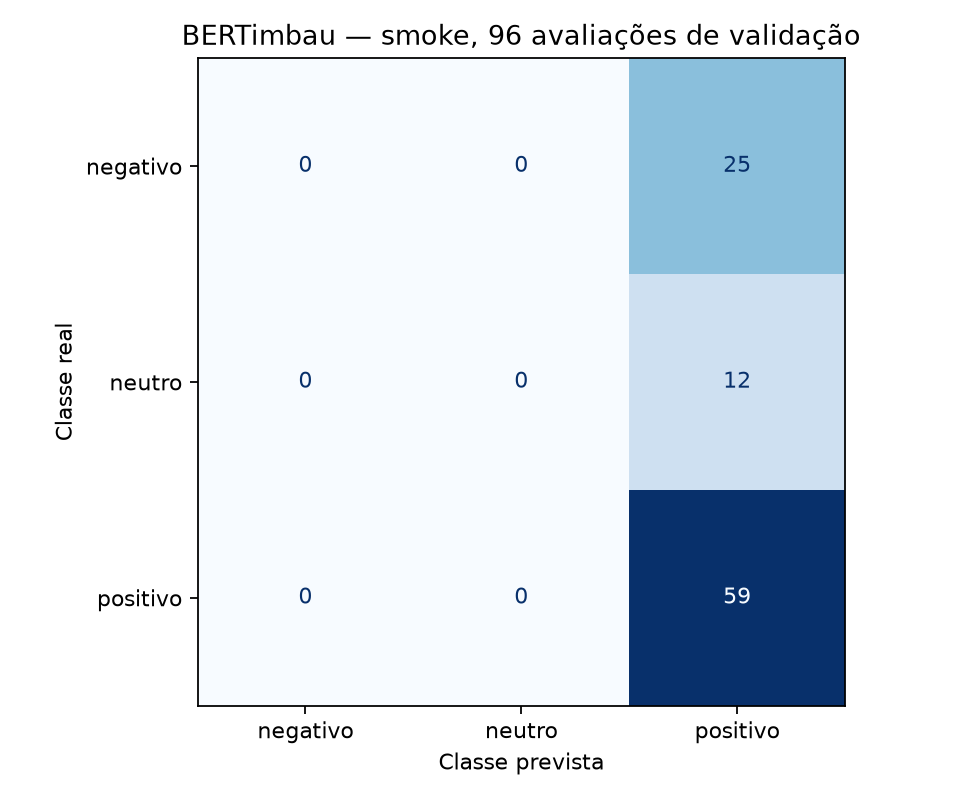

# Fase 3A — Diagnóstico e smoke do BERTimbau

**Concluída tecnicamente em 30/10/2026**, na GPU local. Execução das **11:42:11 às
11:42:23**, horário de Recife. Branch `feat/phase3a-bertimbau-smoke`, a partir da
`main` atualizada (`0eb1aae`). Código executado: `44612e347450182b987231e5c37e8e3d6f641ece`,
com árvore limpa. O JSON registra hashes dos módulos utilizados.

Um ciclo completo de treino, avaliação, salvamento e recarga foi executado com
**256 exemplos de treino e 96 de validação**. Não houve OOM, mudança de configuração,
segunda tentativa, tuning, Colab, publicação no Hub ou leitura do teste final.
**As métricas abaixo são diagnósticas e não medem desempenho definitivo.**

## Ambiente e dependências

- GPU: **NVIDIA GeForce RTX 3050 6GB Laptop GPU**, compute capability **8.6**.
- Driver: **615.78.08**; CUDA do PyTorch: **13.2**; cuDNN: **92400**.
- Python **3.11.14**, Linux local. nvidia-smi informa **6.144 MiB** na placa;
  o PyTorch informa **5.712 GiB** visíveis.
- PyTorch **2.14.1+cu132 foi preservado**, sem substituição por build CPU.
- Transformers, Accelerate e dependências foram acrescentados. Nenhum pacote
  previamente instalado foi atualizado ou removido, conferindo o inventário antes/depois.
- O lock das Fases 1/2 permaneceu intacto. O novo lock usa a constraint explícita
  de Torch CUDA e inclui o lock anterior.

| Biblioteca | Versão usada |
| --- | --- |
| torch | 2.14.1+cu132 |
| transformers | 5.22.1 |
| accelerate | 1.15.0 |
| tokenizers | 0.23.3 |
| safetensors | 0.8.0 |
| huggingface-hub | 2.4.0 |
| numpy | 2.4.6 |
| scikit-learn | 1.9.1 |
| pandas | 3.1.0 |

As alterações de dependências estão em
[phase3a_dependency_changes.json](phase3a_dependency_changes.json). A instalação foi
verificada por `pip check` e pela resolução de `requirements-transformer-lock.txt`.

## Fonte, amostragem e configuração

Checkpoint: `neuralmind/bert-base-portuguese-cased`, revisão
`94d69c95f98f7d5b2a8700c420230ae10def0baa`. Carga do `pytorch_model.bin` original,
sem conversão remota, `trust_remote_code=False`. Encoder pré-treinado mais cabeça
nova para três classes; **108.925.443 parâmetros** no classificador completo.
Todos os parâmetros são treináveis. Mapas explícitos: 0=negativo, 1=neutro, 2=positivo.

O cache já estava preparado; a execução usou `--local-files-only` e modo offline.
O download inicial não faz parte dos tempos desta execução. A licença do checkpoint
base é MIT; o corpus mantém a declaração original CC BY-NC-SA 4.0.

`load_training_data` verificou treino/validação contra os fingerprints congelados da
Fase 1. A amostragem foi estratificada, sem reposição, ordenada por hash e com semente
42; cada amostra saiu exclusivamente do seu split. Os IDs escolhidos ficam somente
em `models/bertimbau/phase3a-v1/samples_manifest.json`, ignorado pelo Git.

| Amostra | Negativo | Neutro | Positivo | Total |
| --- | ---: | ---: | ---: | ---: |
| Treino | 66 | 32 | 158 | 256 |
| Validação | 25 | 12 | 59 | 96 |

Fingerprints das amostras:

- Treino: `2fd273285ba3b6345c23e248899d4b20b8283ab17525f4a76905ee8bed7d4d2a`.
- Validação: `d715f9ed1cffc11c2471ee9aeb5061d7e15a401705da109572975e7b381b15c1`.

Configuração inicial e efetiva foram idênticas:

| Parâmetro | Valor |
| --- | --- |
| max_length | 128 |
| Padding | Dinâmico por lote, múltiplo de 8 |
| Tokenizer | AutoTokenizer cased; sem lowercasing ou remoção de acentos |
| Batch de treino / avaliação | 2 / 2 |
| Gradient accumulation | 8; batch efetivo 16 |
| Épocas | 1 |
| Learning rate | 2e-5 |
| Precisão | FP16 com Accelerate/GradScaler |
| Gradient checkpointing | Desativado; não foi necessário |
| Otimizador | AdamW, weight decay 0,01, foreach=False |
| Scheduler | Decaimento linear, sem warmup |
| Gradient clipping | 1,0 |
| Atenção / TF32 | eager / desativado |

Há **128 microbatches**, **16 atualizações efetivas** e **zero passos pulados** pelo
scaler. Todos os 256 exemplos passaram pelo treino. A loss média foi
**0.937144**, finita; o hash dos pesos da cabeça mudou após treino.
Apenas a amostra de validação foi avaliada, sem selecionar checkpoint por métrica.

## Evidência da GPU e consumo de VRAM

- Parâmetros e input_ids observados em **cuda:0**.
- Saída de camada linear observada em **torch.float16**, também em **cuda:0**.
- Uma operação FP16 real foi aprovada no diagnóstico antes do treino.
- Snapshot nvidia-smi no primeiro update: **92% de utilização de GPU** e
  **3.195 MiB de memória total ocupada na placa**. É uma observação pontual, não
  uma média do treino ou um pico medido de toda a placa.

| Etapa | Pico alocado (GiB) | Pico reservado (GiB) | Alocado ao final (GiB) | Reservado ao final (GiB) |
| --- | ---: | ---: | ---: | ---: |
| Treino | 2.032 | 2.088 | 1.283 | 2.088 |
| Avaliação | 1.294 | 1.422 | 1.283 | 1.422 |
| Avaliação após recarga | 0.480 | 0.525 | 0.469 | 0.525 |

Os picos são do allocator PyTorch e foram reiniciados antes de cada etapa. Eles
não incluem a ocupação completa do desktop, outros processos e contexto/driver.
A avaliação mantém o estado do otimizador; o cache livre é limpo antes da medição.
Na recarga, modelo e otimizador anteriores já haviam sido liberados.

| Medição | Duração |
| --- | ---: |
| Treinamento completo da amostra | 5.492 s |
| Avaliação dos 96 exemplos | 0.423 s |
| Nova avaliação após recarga | 0.425 s |
| Execução total até escrever o relatório | 12.500 s |

Treino/avaliação usam relógio de parede e sincronização CUDA; incluem collator,
transferências e operações do loop. Download, tokenização, métricas e serialização
ficam fora dessas duas medições e entram no tempo total quando executados. Os tempos
não representam um benchmark estabilizado nem permitem estimar diretamente o treino
completo: a amostra é pequena e o padding é dinâmico.

## Métricas diagnósticas da validação

| Accuracy | Precision macro | Recall macro | F1 macro |
| ---: | ---: | ---: | ---: |
| 0.6146 | 0.2049 | 0.3333 | 0.2538 |

| Classe | Precision | Recall | F1 | Suporte |
| --- | ---: | ---: | ---: | ---: |
| negativo | 0.0000 | 0.0000 | 0.0000 | 25 |
| neutro | 0.0000 | 0.0000 | 0.0000 | 12 |
| positivo | 0.6146 | 1.0000 | 0.7613 | 59 |

Todas as 96 predições foram **positivo**. Não foi demonstrada capacidade de
separar as três classes com esse orçamento. A atualização dos pesos e a execução
técnica foram comprovadas; a eficácia preditiva exige treino e avaliação próprios
na Fase 3B. Não se compara este F1 com o baseline treinado em 88 mil exemplos.
A métrica baixa não motivou tentativas adicionais ou alterações nos hiperparâmetros.

Matriz de confusão, linhas reais e colunas previstas:



## Checkpoint, recarga e preservação

Modelo e tokenizer foram salvos localmente em
`models/bertimbau/phase3a-v1/attempt-1/checkpoint/` e recarregados sem rede.

- Safetensors, com checksum de cada arquivo registrado no JSON.
- Tokenização dos 96 textos idêntica após recarga.
- id2label/label2id conferidos.
- Predições idênticas; diferença máxima absoluta dos logits **0,0**.
- Logits aprovados também pelo teste com rtol/atol de 1e-4.
- Artefatos das Fases 1 e 2 preservados, inclusive o checksum do modelo clássico.
- SHA-256 de train.csv, val.csv e manifest.json iguais antes/depois.
- Guarda de abertura do teste ativa: **zero tentativas de abrir test.csv**.
  O teste não foi lido nem para checksum, validação ou qualquer inspeção.

Pesos, cache e IDs individuais permanecem fora do Git. Somente código, configurações,
testes, documentação, figuras e estatísticas agregadas são versionados. Evidências
completas: [bertimbau_smoke_metrics.json](bertimbau_smoke_metrics.json).

## Testes e problemas encontrados

A suíte completa passou **125 testes em modo offline**, incluindo todos os testes
anteriores. Ruff (lint e formatação) e `pip check` também passaram. Os testes novos
cobrem limites de configuração, rótulos, amostragem determinística, disjunção e
origem dos dados, caixa/acentos, padding dinâmico e recarga de BERT minúsculo em CPU.
OOM é simulado para verificar no máximo duas tentativas e propagação de erros não OOM.
Não há dependência de GPU ou download do checkpoint para executar a suíte comum.

Não houve OOM real, erro CUDA, incompatibilidade de dependências ou ajuste da
configuração durante a execução. O relatório de carga mostrou parâmetros da cabeça
de pré-treinamento não utilizados e uma cabeça classificadora inicializada do zero;
essas mensagens são esperadas ao trocar de tarefa. Os pesos do encoder foram carregados.
O caminho alternativo de OOM foi validado por simulação, não por esgotamento real da placa.

O limite observado é a predição só da classe positiva, com apenas 16 atualizações.
O relatório não atribui uma causa única: tamanho, orçamento e supervisão por estrelas
precisam de análise em uma fase de treinamento propriamente dita.

## Recomendações para a Fase 3B

1. Começar pela configuração já viável: FP16, batch 2, acumulação 8 e max_length 128.
   Manter batch 1 + checkpointing como alternativa de memória, sem ativá-la agora.
2. Ampliar o orçamento de forma explícita e gradual; acompanhar loss, atualizações
   efetivas, F1 macro e recall por classe. Accuracy isolada esconde o comportamento
   de prever sempre positivo. Não escolher hiperparâmetros com o teste final.
3. Medir comprimentos no treino antes de aumentar max_length. Neste smoke, média de
   **38,75 tokens** no treino, com **6/256 (2,34%)** no limite de 128. Na validação,
   nenhum atingiu o limite. Isso não estima com precisão a cauda da base inteira.
4. Se aumentar comprimento ou batch, repetir uma medição limitada de VRAM. O pico
   atual não garante memória suficiente para outra configuração.
5. Medir throughput sustentado e comportamento térmico em uma execução maior antes
   de estimar custo/duração do treinamento completo. O teste final continua reservado.

## Reprodução

Com PyTorch CUDA já instalado e validado, na raiz:

```bash
.venv/bin/python -m pip install -r requirements-transformer-lock.txt
.venv/bin/python -m reviewsense.train_transformer \
  --config configs/bertimbau_smoke.json \
  --output-dir models/bertimbau/phase3a-v2 \
  --local-files-only
HF_HUB_OFFLINE=1 TRANSFORMERS_OFFLINE=1 .venv/bin/pytest -q
```

`--local-files-only` exige o cache do checkpoint; omita essa opção no primeiro
uso sem cache. Cada nova execução deve ter uma saída ausente. Os comandos não
regeneram os splits e não acessam o teste. Guia de decisões e funções:
[FASE3A_BERTIMBAU_SMOKE.md](../docs/FASE3A_BERTIMBAU_SMOKE.md).
