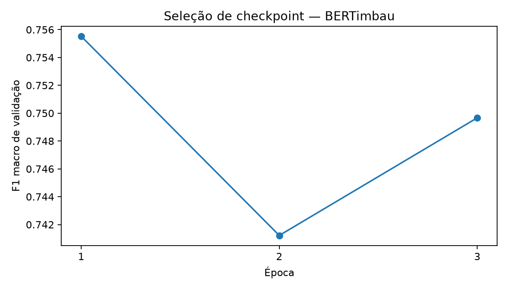
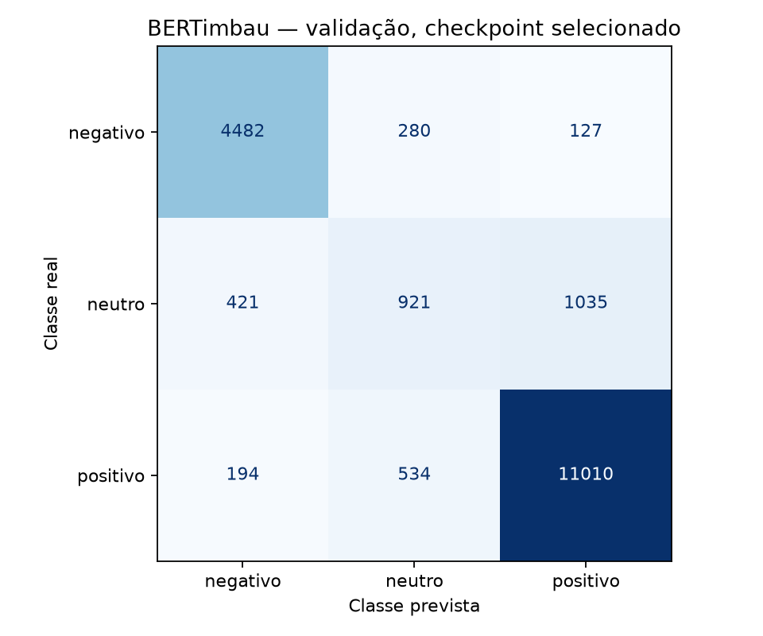

# Fase 3B — RTX 3050: piloto, retomada e fine-tuning completo

Execução local em 30/10/2026, branch `feat/phase3b-bertimbau-local`. O treinamento
completo foi iniciado somente após aprovação de estabilidade/memória no piloto,
prova de retomada em processos separados e testes offline. Não houve leitura do
teste final, alteração de splits, Colab ou publicação no Hub.

## Todos os comprimentos antes do truncamento

Tokenizer cased do checkpoint fixado; CLS/SEP incluídos, sem truncamento ou padding.
Percentis lineares e porcentagens estritamente acima dos limites.

| Split | Textos | P50 | P90 | P95 | P99 | >128 | >256 |
| --- | ---: | ---: | ---: | ---: | ---: | ---: | ---: |
| train | 88684 | 26.00 | 69.00 | 95.00 | 177.00 | 2.3522% | 0.3586% |
| val | 19004 | 26.00 | 71.00 | 98.00 | 181.97 | 2.4469% | 0.4157% |

Treino: média 37.16, máximo 2357 tokens.
Validação: média 37.42, máximo 1448.
Agregados completos: [phase3b_token_lengths.json](phase3b_token_lengths.json).
Features individuais e planos de amostragem permanecem somente no cache local.

## Benchmark controlado

Mesmos 256 exemplos representativos e 64 textos mais longos do treino em todas as
variantes, dois regimes separados e duas passagens por regime, após 32 exemplos
de aquecimento. Os 64 longos têm 422–2.357 tokens antes do corte, forçando lotes
inteiros no limite. Batch efetivo 16, LR 2e-5, FP16, AdamW foreach=False, atenção eager.
Throughput inclui forward/backward/clipping/otimizador e transferências, com
sincronização CUDA; exclui tokenização, carga do modelo e aquecimento.

| max_length/batch | Ex/s representativos | Ex/s longos | Pico alocado PT GiB | Pico reservado PT GiB | Pico driver GiB | Livre mínimo driver GiB | Updates pulados |
| --- | ---: | ---: | ---: | ---: | ---: | ---: | ---: |
| 128/2 | 44.01 | 36.27 | 2.031 | 2.088 | 3.539 | 2.461 | 0 |
| 256/2 | 44.43 | 24.27 | 2.227 | 2.260 | 3.673 | 2.327 | 0 |
| 256/4 | 60.00 | 29.96 | 2.570 | 2.684 | 4.100 | 1.900 | 1 |

Os números são da rodada com escala inicial FP16 16.384. NVML amostra a cada
50 ms; sua ocupação inclui desktop, driver e outros processos. O máximo do driver
é amostrado e não um pico contínuo exato. Picos do PyTorch incluem criação do
estado do AdamW no aquecimento. Não houve OOM nas três variantes.

**Escolhido: 256 tokens, batch 2, acumulação 8.** Batch 4 teve margem superior a
1 GiB, mas apresentou overflow tratado no regime longo. Batch 2 passou sem perda
não finita, gradiente não finito ou update pulado no piloto controlado. Nenhuma
métrica de qualidade foi usada para escolher a configuração. A alternativa batch
1/acumulação 16 com gradient checkpointing está implementada e não precisou ser executada.

A escala padrão 65.536 foi testada primeiro e produziu overflows protegidos nas
variantes de 256 tokens. Uma única adaptação numérica foi definida: escala inicial
16.384 e intervalo de crescimento 1.000.000 (sem crescimento no orçamento deste treino).
A grade fixa foi repetida. Uma rodada intermediária com repasse incorreto da escala
foi descartada; a escala efetiva das medições válidas é registrada. Não houve busca
por F1, learning rate ou outro hiperparâmetro de qualidade.
Evidências: [phase3b_gpu_pilot.json](phase3b_gpu_pilot.json).

## Prova de retomada antes do treinamento completo

Controle contínuo de quatro updates versus interrupção após dois e retomada até
quatro, em processos CUDA separados. A configuração e os dados foram os mesmos.
Pesos finais e estados de optimizer, scheduler e scaler foram idênticos. O teste
verifica continuação real, ordem/RNG e estado de otimização, não só inferência após
carregar pesos. A mesma capacidade é coberta em CPU com um BERT minúsculo offline.
O gate também ancora hash do código e do cache e exige memória livre inicial suficiente.

A CE é normalizada explicitamente pelo número real de exemplos no batch acumulado.
Isso evita uma incompatibilidade desta versão entre a assinatura do BERT e a
inferência automática de loss normalizada do Trainer. Há teste de equivalência
entre gradientes do batch inteiro e de seus microbatches. O último grupo de cada
época tem 12 exemplos; nenhum texto é descartado para completar batch 16.

## Treinamento completo

- Checkpoint original `neuralmind/bert-base-portuguese-cased`, revisão
  `94d69c95f98f7d5b2a8700c420230ae10def0baa`, sem reutilizar pesos do smoke.
- **88.684 textos de treino e 19.004 de validação**, splits congelados.
- **Três épocas**, max_length 256, batch 2/acumulação 8, batch de avaliação 2,
  FP16, LR inicial 2e-5, scheduler linear sem warmup e clipping 1,0.
- AdamW foreach=False, weight decay 0,01, exceto bias/LayerNorm pelo agrupamento
  padrão do Trainer. Não houve nova busca de hiperparâmetros.
- Seleção pelo **F1 macro da validação completa**, ao fim de cada época.
- Checkpoints completos a cada 500 updates e ao fim das épocas; retenção do melhor
  e do mais recente. Pesos, tokenizer, optimizer, scheduler, scaler, RNG e posição
  dos dados foram salvos em artefatos locais.

Commit no início do treinamento: `0dd1ed9a4de1a9884bf1eda4623c70a97671b59a`.
HEAD na escrita do resultado: `2cdcfd0bc53786b7bcb4e3f26dfe599f0a4453e2` (inclui documentação posterior).
Hash do runtime, conferido sem alteração:
`3209e9b5a13f2aea79a8a3c7ac6e52d4f38b0fbb7fe6ab746773e32c27dfacb8`. Configuração e versões completas estão no JSON final.

| Época | Update | F1 macro | Precision macro | Recall macro | Accuracy |
| --- | ---: | ---: | ---: | ---: | ---: |
| 1 | 5543 | 0.755522 | 0.771571 | 0.747398 | 0.863660 |
| 2 | 11086 | 0.741218 | 0.773069 | 0.730067 | 0.863818 |
| 3 | 16629 | 0.749669 | 0.765367 | 0.740811 | 0.860187 |

Checkpoint selecionado: `models/bertimbau/phase3b-full-v3/checkpoint-5543`.

| Classe | Precision | Recall | F1 | Suporte |
| --- | ---: | ---: | ---: | ---: |
| negativo | 0.879341 | 0.916752 | 0.897657 | 4889 |
| neutro | 0.530836 | 0.387463 | 0.447957 | 2377 |
| positivo | 0.904535 | 0.937979 | 0.920954 | 11738 |





Comparação descritiva nos mesmos splits completos:

| Modelo | F1 macro de validação | Accuracy de validação |
| --- | ---: | ---: |
| Baseline TF-IDF + LinearSVC | 0.727137 | 0.835193 |
| BERTimbau selecionado | 0.755522 | 0.863660 |

Ambos usaram a validação para seleção; isto não é estimativa independente de
performance final. O teste continua reservado. O smoke de 256/96 não é comparado
como resultado definitivo.

## Memória, duração e estabilidade

- GPU: NVIDIA GeForce RTX 3050 6GB Laptop GPU; Torch 2.14.1+cu132; CUDA
  13.2; Transformers 5.22.1;
  Accelerate 1.15.0; driver 615.78.08.
- Pico PyTorch no processo completo: **2.232 GiB alocados**,
  **2.287 GiB reservados**.
- Pico amostrado pelo driver: **4.118 GiB**;
  memória livre mínima **1.882 GiB**.
- Duração registrada do treino/validações/checkpoints: **6344.6 s**.
  O Trainer informa train_runtime **6344.0 s**.
- Avaliação por época: 100.476 s, 94.469 s, 99.904 s.
  A duração isolada da predição final do checkpoint selecionado não foi instrumentada.
- 16629 grupos de update processados;
  **3 updates pulados pelo GradScaler**,
  **16626 updates efetivos**.
- **Zero losses não finitas e zero pesos não finitos**. Houve
  3 normas não finitas isoladas, com
  3 recuperações protegidas e verificadas.
  Escala do último checkpoint: **2048.0**.

A execução inicial parou antes do primeiro checkpoint, após o último log de 200
updates, porque o verificador tratava todo overflow de gradiente como fatal.
A supervisão foi corrigida para permitir o mecanismo padrão do GradScaler: pular
update, reduzir escala e confirmar pesos finitos. Uma prova CUDA com overflow
intencional confirmou escala 16.384→8.192, pesos intactos no skip e update seguinte
válido. Três skips consecutivos ou taxa acima de 1% após mil updates interrompem.
A retomada foi refeita após a correção. O treino final começou do checkpoint original
em pasta nova, sem mudar LR, batch, dados ou selecionar configurações por qualidade.
As duas tentativas interrompidas permanecem locais: a primeira pela supervisão
excessiva; a segunda por dupla chamada de `unscale_` no Trainer ao receber uma
norma ausente. O runtime final impede essa segunda chamada e foi validado pelo
teste CUDA e pela nova prova de retomada antes de iniciar a full-v3.

## Verificação e reprodução

- 143 testes offline aprovados; Ruff e pip check aprovados.
- Checkpoints completos conferidos; melhor modelo salvo corresponde ao checkpoint
  selecionado por hash dos pesos. Uma recarga offline em CPU confirmou mapeamentos,
  pesos finitos e inferência finita em texto sintético. O notebook 03 foi executado
  localmente, reutilizando os resultados salvos, e mantido sem outputs no Git.
- SHA-256 de train.csv, val.csv e manifest.json preservados antes/depois.
- Zero tentativas de abrir test.csv. Artefatos e métricas das Fases 1, 2 e 3A intactos.
- Nenhum peso, token individual, dado ou estado de optimizer entrou no Git.

Guia completo e comandos de preparação/piloto/retomada/treino:
[FASE3B_BERTIMBAU.md](../docs/FASE3B_BERTIMBAU.md).
Para retomar, use o checkpoint completo mais recente, mantendo configuração e gate:

```bash
.venv/bin/python -m reviewsense.phase3b train --resume models/bertimbau/phase3b-full-v3/checkpoint-16629
```

A execução já concluída tem três épocas; o comando acima ilustra a retomada com o
mesmo orçamento, não autoriza épocas adicionais. `best_model/` tem apenas pesos e
tokenizer e não substitui o checkpoint retomável.

Métricas, tempos e estado agregado:
[bertimbau_phase3b_metrics.json](bertimbau_phase3b_metrics.json).

As limitações continuam: estrelas como proxy, avaliações de comércio eletrônico
de 2018, cauda truncada, possíveis quase duplicatas/autores/produtos compartilhados,
validação usada na seleção e ausência de avaliação no teste final.
