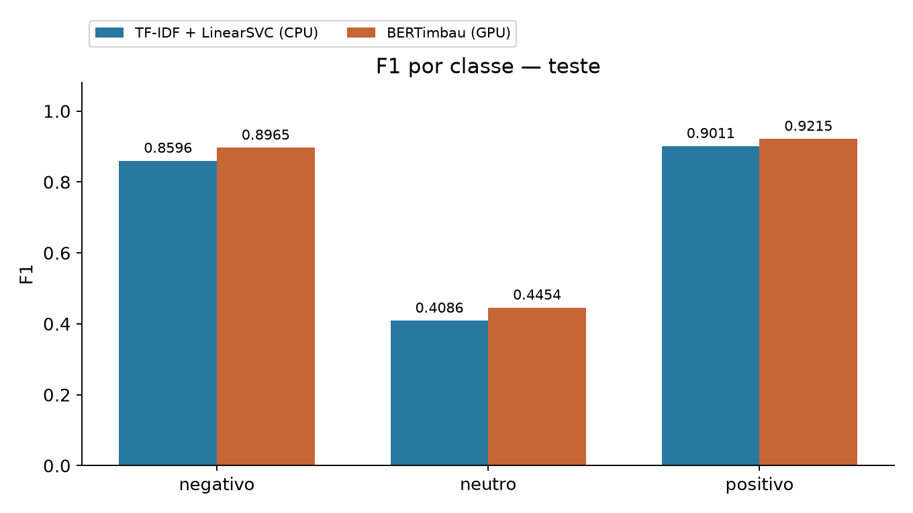
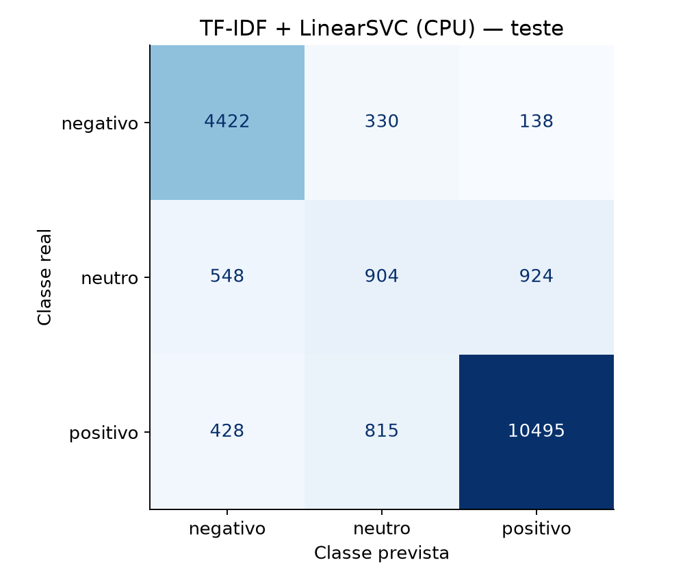
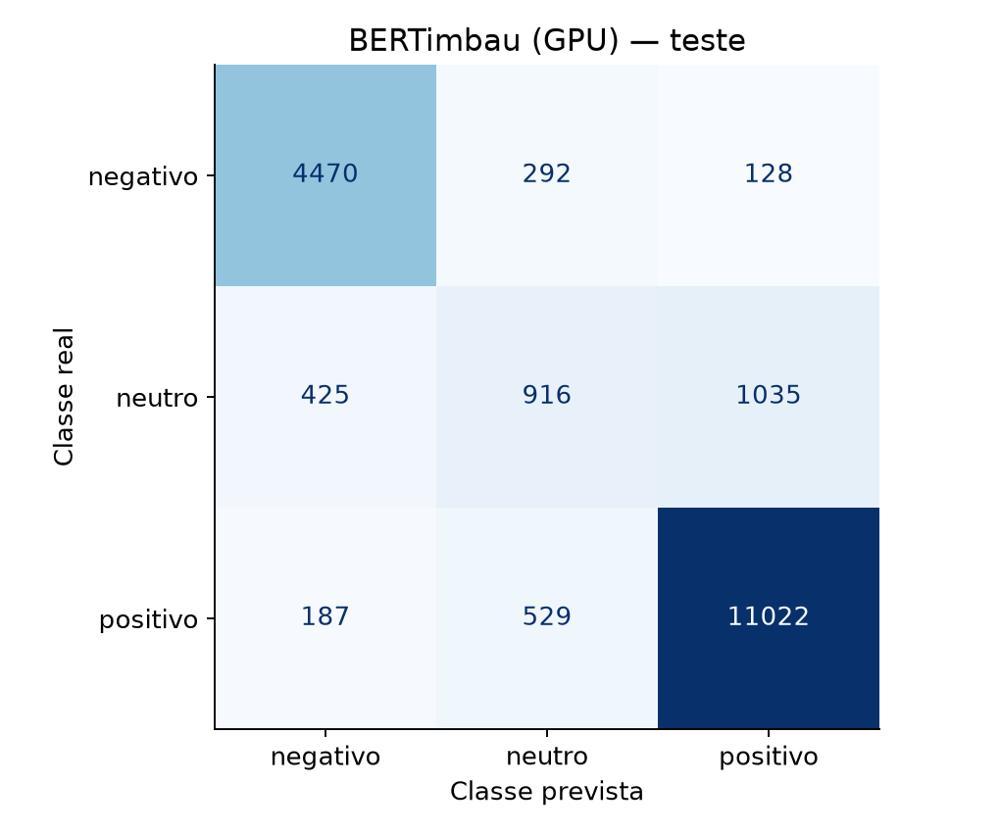
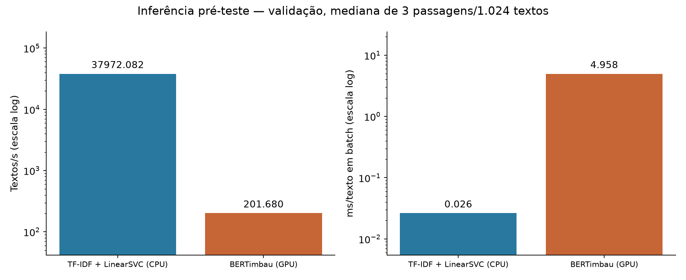

# Fase 3C — Avaliação final independente

Execução local definitiva: 2026-10-30T15:52:19.791050-03:00 a 2026-10-30T15:53:58.752652-03:00.
Commit congelado `90893aa3fe3053433e3e72a22977fc40747bed5f`, branch `feat/phase3c-final-evaluation`, árvore limpa.
O protocolo [FASE3C_PROTOCOL.md](../docs/FASE3C_PROTOCOL.md) foi versionado antes
da abertura do teste. Nenhum treinamento, refit, calibração ou seleção nesta fase.
BERTimbau já era o candidato principal; o teste não redefine essa escolha.

## Procedimento e dados

B2W-Reviews01 da Americanas, avaliações de produtos de 2018. Fonte/revisão e
fingerprints ancorados na Fase 1. Licença original **CC BY-NC-SA 4.0**; sem
redistribuição ou presunção de autorização comercial. Estrelas são proxy de
sentimento: negativo 0 (1–2), neutro 1 (3), positivo 2 (4–5).

Teste congelado: **19004** exemplos. Ambos receberam os mesmos textos,
rótulos e ordem. Conferidos esquema, nulos, normalização existente, IDs, unicidade,
ordem do manifest, fingerprints/distribuição, disjunção e fingerprint global.
Somente review_text como feature. Os dados não foram corrigidos nem regenerados.

- Preflight: **zero leituras/tentativas bloqueadas** do teste; guarda de abertura ativa.
- Preparação da execução definitiva: **0 leituras** do teste.
- Final: **1 abertura de leitura**, 0 bloqueadas;
  hash e parsing a partir do mesmo buffer. Uma passagem de inferência por modelo.
- Registro exclusivo criado antes da leitura; falhas não permitem repetição automática.
- SHA do CSV: `8d895cf230ad142755e6c3f39bf3269cfc5eabd8db3c6df0377dd3124eb187db`.
- Fingerprint preparado: `3c2c5d9cf600821a8fdf7be5fc630c621bb4453616fdffc5d45d69baf40a5a57`; sobreposição de IDs: zero.
- Arquivos de entrada/modelos com hashes preservados; stat do teste inalterado.

SVM: pipeline da Fase 2, C=0,1, ngrams=(1,2), class_weight=balanced, 80.000 features.
BERTimbau: época 1/update 5543 da Fase 3B, best_model igual a checkpoint-5543;
origem neuralmind/bert-base-portuguese-cased, revisão
94d69c95f98f7d5b2a8700c420230ae10def0baa. Inferência offline/cuda:0, eval,
inference_mode, FP16, max_length=256 e padding dinâmico/múltiplo de 8.

## Resultados reais de teste

| Modelo | F1 Macro | Precision Macro | Recall Macro | Accuracy |
| --- | ---: | ---: | ---: | ---: |
| svm | 0.723094 | 0.722830 | 0.726290 | 0.832509 |
| bertimbau | 0.754461 | 0.770492 | 0.746211 | 0.863397 |

ΔF1 Macro BERT−SVM: **+0.031367** (+3.1367 pontos percentuais),
variação relativa **+4.3379%** sobre o SVM. A vantagem descritiva de F1 Macro observada na validação se manteve no teste.
Comparação descritiva; sem bootstrap, intervalo de confiança ou alegação de
superioridade estatística. Valores de validação anteriores permanecem inalterados
(SVM 0,727137; BERT 0,755522).

| Modelo | Classe | Precision | Recall | F1 | Suporte |
| --- | --- | ---: | ---: | ---: | ---: |
| svm | negativo | 0.819192 | 0.904294 | 0.859642 | 4890 |
| svm | neutro | 0.441191 | 0.380471 | 0.408588 | 2376 |
| svm | positivo | 0.908108 | 0.894105 | 0.901052 | 11738 |
| bertimbau | negativo | 0.879575 | 0.914110 | 0.896510 | 4890 |
| bertimbau | neutro | 0.527346 | 0.385522 | 0.445417 | 2376 |
| bertimbau | positivo | 0.904555 | 0.939002 | 0.921456 | 11738 |

Diferenças por classe (BERT−SVM):

- negativo: ΔPrecision +0.060383, ΔRecall +0.009816, ΔF1 +0.036868.
- neutro: ΔPrecision +0.086155, ΔRecall +0.005051, ΔF1 +0.036829.
- positivo: ΔPrecision -0.003553, ΔRecall +0.044897, ΔF1 +0.020405.

## Neutros e concordância pareada

| Modelo | Neutros corretos | Neutros → negativos | Neutros → positivos |
| --- | ---: | ---: | ---: |
| svm | 904 | 548 | 924 |
| bertimbau | 916 | 425 | 1035 |

As diferenças de Precision e Recall acima mostram os ganhos/perdas separadamente;
as matrizes são evidência de contagens, não explicação causal dos erros.

- Ambos acertaram: **15290**.
- Ambos erraram: **2065**.
- Somente SVM acertou: **531**.
- Somente BERTimbau acertou: **1118**.
- Soma: **19004**; isso não identifica correlação entre autores/produtos.

Matrizes com ordem negativo/neutro/positivo, linhas reais e colunas previstas:

## Desempenho computacional

CPU: 13th Gen Intel(R) Core(TM) i5-13450HX, 16 CPUs lógicas;
SVM limitado a uma thread. GPU: NVIDIA GeForce RTX 3050 6GB Laptop GPU; BERT usa duas threads CPU e
FP16. Software: Python 3.11.14, Torch 2.14.1+cu132,
Transformers 5.22.1, sklearn 1.9.1.
CUDA 13.2. Versões e snapshot do driver estão no JSON.

Benchmark **antes de abrir o teste**: mesmos 1.024 textos de validação, amostragem
estratificada seed 42, índices ordenados; warm-up 32 textos/modelo e três repetições.
Mediana por passagem, sincronização CUDA, inclui tokenização/TF-IDF, transferências
e predição; exclui carga, aquecimento, I/O e cálculo de métricas.

| Modelo | Batch | Passagem mediana (s) | Textos/s | ms/texto amortizado |
| --- | ---: | ---: | ---: | ---: |
| svm | 256 | 0.026967 | 37972.08 | 0.026335 |
| bertimbau | 2 | 5.077350 | 201.68 | 4.958349 |

Passagem **única** pelo teste, sem repetir ou ajustar configurações:

| Modelo | Passagem 19.004 (s) | Textos/s | ms/texto amortizado | Erros | Fração de erros |
| --- | ---: | ---: | ---: | ---: | ---: |
| svm | 0.412636 | 46055.07 | 0.021713 | 3183 | 16.7491% |
| bertimbau | 97.387751 | 195.14 | 5.124592 | 2596 | 13.6603% |

Throughput amortizado em batch não é latência individual (não medida). CPU e GPU
são infraestruturas diferentes; temperatura, frequência e outros processos não
foram isolados. O tempo do teste também inclui condições iniciais dessa passagem.

- RSS pico amostrado do processo na passagem SVM:
  1600.10 MiB.
  Inclui ambos os modelos carregados e runtime; **não** é memória exclusiva do SVM.
  Amostragem Linux de 10 ms, não um pico contínuo exato.
- Inferência BERT/teste: PyTorch pico alocado
  **0.459 GiB**,
  reservado **0.646 GiB**;
  driver pico amostrado **1.983 GiB**,
  livre mínimo **4.017 GiB** (NVML 50 ms,
  inclui desktop/driver/outros processos).
- Artefato SVM: 2,772,715 bytes joblib comprimido.
  BERT pesos: 435,725,300 bytes; tokenizer: 678,376 bytes.
- Treino histórico SVM selecionado: 3.878721 s;
  busca+validação completa: 62.630196 s.
  BERT: 6344.631 s para
  três épocas com validações/checkpoints. Escopos diferentes, sem novo treino.

## Auditoria e limitações

Hashes dos artefatos e referências (hashes do código também constam no JSON):

| Arquivo relativo ao repositório | SHA-256 |
| --- | --- |
| `configs/phase3c_final.json` | `3c98596d536ea5409136be285247c0d0ab8449bffb28c8a6fab13f2c7af2319b` |
| `docs/FASE3C_PROTOCOL.md` | `a664dabc140d9bb05dce9ee58ecb48f73d6f81aeef8711618247cdb6a2a2b45e` |
| `reports/data_audit_summary.json` | `8b02a1e3584c361bdbf57e7fc5ffa1904daaa7448a6aa80a9563f1eec42ebade` |
| `reports/baseline_validation.json` | `aba24f67a633d052ace94b7d7db4dfefc1b03885b696af4094f58bd5847bc8f6` |
| `reports/bertimbau_phase3b_metrics.json` | `5b231d9b67bd2572cea0e7446f10bdd590099803700ba7808b6a5fd62728248c` |
| `data/processed/phase1-final/manifest.json` | `6469cafdd878deeadfd9ac20083ce6b3d5ec6856a1c6478716589a4978fa8bcd` |
| `data/processed/phase1-final/train.csv` | `d6508aa963d2877398501d4b8b7f9ba17653fed8fed12ad26b7d00af31aca52c` |
| `data/processed/phase1-final/val.csv` | `e743636fe5aad8c3a71c0625e5f5585bbd318e11812f4cfcc1cd371b7ad6daed` |
| `models/baseline/phase2-v1/selected_model.joblib` | `9b9d5465583c836bc5ecafb50e1407b20992a5b1adf3e4986878914718583623` |
| `models/baseline/phase2-v1/results.json` | `aba24f67a633d052ace94b7d7db4dfefc1b03885b696af4094f58bd5847bc8f6` |
| `models/baseline/phase2-v1/config.json` | `568c26d6b8ddc2297a56c5d8144688f2a0f5f0d41e33addec1230f57de45138c` |
| `models/bertimbau/phase3b-full-v3/best_model/model.safetensors` | `a65f1ee302987c5f0b01cd7981722e92f17ff332358b8e19b8dc01ee05753c70` |
| `models/bertimbau/phase3b-full-v3/checkpoint-5543/model.safetensors` | `a65f1ee302987c5f0b01cd7981722e92f17ff332358b8e19b8dc01ee05753c70` |
| `models/bertimbau/phase3b-full-v3/best_model/config.json` | `2389ccb3801ce52974ec8501f258cdb3ebc8006bdea439f49e47a330dcd93223` |
| `models/bertimbau/phase3b-full-v3/best_model/tokenizer.json` | `ed6341298b0e748c076332b22e895ec601d33053de0ff6b8dae8c846cce961bb` |
| `models/bertimbau/phase3b-full-v3/best_model/tokenizer_config.json` | `32f7a4b0527717d3c7bd79f5c0edda7baeb8a5f3b9e16c6cb22df5fd581c9a1a` |
| `models/bertimbau/phase3b-full-v3/checkpoint-5543/config.json` | `2389ccb3801ce52974ec8501f258cdb3ebc8006bdea439f49e47a330dcd93223` |
| `models/bertimbau/phase3b-full-v3/checkpoint-5543/tokenizer.json` | `ed6341298b0e748c076332b22e895ec601d33053de0ff6b8dae8c846cce961bb` |
| `models/bertimbau/phase3b-full-v3/checkpoint-5543/tokenizer_config.json` | `32f7a4b0527717d3c7bd79f5c0edda7baeb8a5f3b9e16c6cb22df5fd581c9a1a` |

Resultados estruturados: [phase3c_final_metrics.json](phase3c_final_metrics.json).
Guia e comandos: [FASE3C_FINAL_EVALUATION.md](../docs/FASE3C_FINAL_EVALUATION.md).
As figuras/notebook só reabrem agregados, sem ler teste ou inferir novamente.

Não há explicação causal dos erros, probabilidades calibradas ou evidência de
generalização para delivery, outros domínios ou períodos. Os rótulos são proxy;
há truncamento e possíveis quase duplicatas/autores/produtos compartilhados.
Disjunção de textos idênticos não garante independência desses fatores.
O teste foi reservado até este protocolo; depois desta execução deixa de ser
informação não observada e não deve guiar novos ajustes neste experimento.
Publicação, Model Card e Gradio ficam para a Fase 4.

## Leitura técnica e verificação da entrega

O BERTimbau recuperou **916 neutros contra 904** do SVM: 12 acertos adicionais.
A Precision neutra aumentou de **44,1191% para 52,7346%**; o Recall passou de
**38,0471% para 38,5522%**. Ambos melhoraram, com ganho maior em Precision.
O número de neutros previstos como positivos aumentou de **924 para 1.035**;
os previstos como negativos caíram de **548 para 425**. O Recall neutro continua
sendo uma limitação importante, apesar do F1 maior.

O F1 aumentou em todas as classes: **+0,036868 negativo, +0,036829 neutro e
+0,020405 positivo**. A melhoria de F1 abrange as três classes. Em contagens de
acertos, 527 dos 587 acertos líquidos adicionais são positivos (48 negativos e
12 neutros): o ganho absoluto de Accuracy está concentrado na classe majoritária.
Essa distinção evita confundir ganho de Accuracy com melhoria uniforme de Recall.
Não se infere a causa dos erros a partir dessas contagens.

A suíte completa teve **173 testes offline aprovados antes e depois** da avaliação.
Ruff (lint/formatação) e pip check passaram. O notebook 04 executou as quatro
células originais sem erros e com zero acessos ao teste, ficando sem outputs no Git.
A suíte final também usou uma guarda sobre o teste real e registrou zero aberturas.
Modelos anteriores, manifest, treino/validação e código/configuração/protocolo
congelados foram reconferidos sem reabrir o teste. Nenhuma falha ou repetição da
execução final foi necessária; o registro exclusivo está concluído.

Evidências anteriores ao teste: [phase3c_preparation.json](phase3c_preparation.json).
Verificação final: [phase3c_verification.json](phase3c_verification.json).
A avaliação não alterou a escolha do candidato principal e não autoriza novos
ajustes neste teste observado. Nenhum dado individual, peso ou checkpoint foi
versionado. Não houve publicação, push, merge ou uso de Colab.
